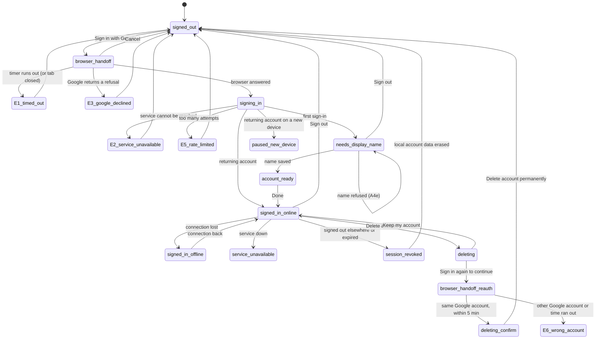

# Account registration UX: first sign-in and account creation

Author role: frontend designer (an agent). This is a design proposal, not human approval, not a legal review and not product code.
Artboard: [`visuals/command-deck/register.html`](visuals/command-deck/register.html) (static; open it over HTTP or from disk).

Labels used here: **DECIDED** = fixed by the task baseline or by a recorded owner statement. **BINDING** = taken from
[ACCOUNT-IDENTITY-REVIEW](ACCOUNT-IDENTITY-REVIEW.md) section 1 or section 5, which the task makes binding for this design (the review itself is still `not_approved`).
**DESIGN** = my choice, for the owner to accept or change. **PROPOSED** = needs an owner or backend answer before it is built.

## 1. What is fixed and what this adds

Fixed (DECIDED, not reopened): Google sign-in only, in the system browser (loopback + PKCE), scope `openid` only. No email, no password, no recovery flow,
no Steam link, no G-Maiden or GID wording. The display name is typed in Kohbor (1 to 32 characters) and never read from Google. The friend code is minted by
the service (`KB-` prefix) and can be replaced. Guests keep every local feature. "Signing in shares nothing" stays beside the sign-in action. Every failed
friend request uses one wording. Command Deck is the only design system; the app uses the two-rail shell and the website borrows no app chrome.

This document adds: the screen states, their order, the copy in Thai and English, accessibility rules, and the list of events and data the UI needs.
It defines no API, endpoint, storage or token format. The backend designer owns those (`ACCOUNT-DATABASE-DESIGN.md`).

## 2. Surfaces

| Surface | Where | What it does | What it must never do |
| --- | --- | --- | --- |
| App: Account destination | Centre region of the two-rail shell, opened from the right rail's account control | The whole flow: guest, sign-in hand-off, display name, friend code, account screen, errors | Open a browser during a live match; take focus from the game; show a credential field; prefill anything from Google or Steam |
| App: right-rail account control | Right rail (exists today as the account flyout) | Shows the account state in words and opens the Account destination | Carry the flow itself; show an error dialog |
| System browser | The user's default browser | Google's own sign-in page, then a "you can go back to Kohbor" result page served on loopback by the native host | Show Kohbor fields, collect a name, or keep the tab needed after the answer |
| Website entry | One explainer section on a landing page (not owner-approved, not hosted) | Says what an account is and is not, says guests are fine, hands off to the app | Collect anything: no form field, no cookie, no tracking, no script; no rails, sidebars or status readouts |

The loopback result page (the page the browser shows after Google redirects back) is in scope only as copy (section 6.9). Its markup belongs to the native host work.

## 3. Flow

State names in lower case match `ACCOUNT_STATES` in `apps/desktop/src/account/s1c/account-slice.mjs` (the existing offline fixture). `account_ready`,
`deleting_confirm` and the `E*` entries are presentation steps inside those states, not new account states.

## 4. States

Ids match the artboard. "Brief" is the scope item number from the task.

| Id | Account state | Brief | Purpose | Leaves by |
| --- | --- | --- | --- | --- |
| A1 | `signed_out`, service open | 1 | Say that an account is optional, offer one action, keep the promise beside it | Sign in → A2 |
| A1b | `signed_out`, service not open | 1 | What ships today: the action is disabled and says why; friend code is "—" | — |
| A1c | `signed_out`, match live | 1, 2 | Do not offer sign-in during a live match | Match ends → A1 |
| A2 | `browser_handoff` | 2 | "Finish in your browser": tell the user where to look, show the time left, allow Cancel | Browser answers → A3; Cancel → A1; timer → E1 |
| A3 | `signing_in` | 2 | Short wait while the service answers | → A4, A7, X2, E2, E5 |
| A4 | `needs_display_name` | 3 | Type the name friends will see; say who sees it | Save → A5; Sign out → A1 |
| A4e | `needs_display_name` | 7 | The service refused the name: keep the text, say what to change | Save again |
| A5 | `signed_in_online`, first time | 4 | Show the user's own friend code with Copy and "Get a new code" | Done → A7 |
| A5b | dialog | 4 | State the consequence of a new code before it happens | Keep / Get a new code |
| A6 | `signed_in_offline` | 5 | "Signed in, offline": social paused, local unaffected, cached values shown as cached | Connection back → A7 |
| A7 | `signed_in_online` | 6 | Account screen: name, code, devices, sign out everywhere, export, delete | — |
| A7b | dialog | 6 | Consequence of signing out everywhere | Cancel / confirm |
| A7c | dialog | 6 | What the export file contains and where it goes | Cancel / choose location |
| A8 | `deleting`, step 1 | 6 | Plain consequences; ask for a fresh Google sign-in | Keep → A7; sign in again → A2 |
| A8b | `deleting`, step 2 | 6 | Final confirmation inside the 5-minute window; then the result notice on A1 | Keep → A7; delete → A1 |
| E1 | `signed_out` | 7 | Browser closed or timed out | Try again → A2 |
| E2 | `service_unavailable` | 7 | Service cannot be reached | Try again |
| E3 | `signed_out` | 7 | Google declined | Try again → A2 |
| E5 | any | 7 | Rate limited | Wait, then try again |
| E6 | `deleting` | 6, 7 | Fresh sign-in used another Google account, or the window ran out | Sign in again / Keep |
| X1 | `session_revoked` | — | Signed out from elsewhere or expired (not in the brief; the fixture has the state) | Sign in → A2 |
| X2 | `paused_new_device` | — | New device: Share list entries paused until confirmed (not in the brief; rule 12) | Share list screen |

"Name invalid" (brief item 7) has two forms: caught before sending (empty, longer than 32: inline in A4) and refused by the service (A4e).

## 5. Design decisions (DESIGN unless marked)

1. **No "continue as guest" button on the Account page.** Being a guest needs no action there. `social.html` D1 draws that button as primary; this replaces it for the Account destination only.
2. **The promise is the button's description.** "Signing in shares nothing" sits beside the sign-in button (BINDING, §5 item 10) and is also wired as its accessible description, so a screen-reader user hears it with the button.
3. **No spinner, no pulse, no progress bar** in A2 and A3. DESIGN-NOTES §5 allows no looping emphasis. A numbered list marks the current step and a countdown is the only changing element.
4. **The Kohbor window never raises itself.** When the browser answers, the Account page changes in place. If Kohbor is behind the browser, the browser's result page tells the user to go back (section 6.9).
5. **Sign-in and delete are not offered during a live match** (BINDING, §5 item 2, extended by me to delete and to the fresh sign-in). The reason is written under the disabled button.
6. **An "also never asks for a password" line** in A1 and A2. It follows ACCOUNT-001 ("no credentials are entered in Kohbor") and helps a user refuse a look-alike window.
7. **Display name step blocks social use, not the app.** Until a name is saved, the Account page stays on A4; every local destination still works. Sign out is the exit. The field starts empty.
8. **The friend code is never drawn as a sample that could be mistaken for real.** Unknown is "—"; every drawn code carries an outlined "example" tag. The code box uses a solid line when live and a dashed line when it is the cached copy (line style is meaning).
9. **"Get a new code" is a neutral confirm, not a danger action.** Friendships survive; the dialog's default focus is "Keep this code".
10. **Exactly one danger-styled button in the flow:** "Delete account permanently" (Signal Rose outline and ▲, per the tokens). The first "Delete account" on A7 uses the same style because it starts that path; "Sign out everywhere" is not danger-styled.
11. **Delete is two steps with the sign-in between them:** consequences → fresh Google sign-in → final confirm with the time left. No typed confirmation word; the fresh sign-in is the proof (BINDING, rule 27).
12. **Service unavailable and rate limited are amber, not rose.** Nothing of the user's is broken. Rose is for failures of the action the user just took.
13. **Errors return to the screen the user came from**, with the message above the action and a "Try again" button. No modal error, no toast that disappears.
14. **The devices list shows no IP address, place or "last active" time.** Rule 26 says the service never keeps IP history or last-seen history. What a row can show is an open question (section 9, Q4).
15. **Wording follows the shipped app: "เข้าสู่ระบบ / ออกจากระบบ"** (`AccountPages.tsx`, `accountView.ts`), not "ลงชื่อเข้าใช้" as in `social.html`. See section 11, conflict 1.
16. **Website: three flat rooms** (Charcoal, Bone, Barber Red) as in the website prototype, built from Command Deck tokens only; a thin text header; one disabled download button marked as a placeholder. Red is a fill with Bone as its only ink and holds the list of things an account does not do.
17. **The website states the no-recovery rule in plain words** ("Good to know"), because it is the one consequence a person should learn before creating an account.

## 6. Copy

Thai first. Plain active voice, sentence case. An error says what happened, whether anything changed, and what to do. Product name in Thai copy: เกาะเบาะ.
Thai wording was written by the author and has not been read by a native-speaking reviewer or tested with users.

### 6.1 Guest (A1, A1b, A1c)

| Key | Thai | English |
| --- | --- | --- |
| guest.title | บัญชี (ไม่บังคับ) | Account (optional) |
| guest.body | ทุกอย่างในเครื่องนี้ใช้ได้โดยไม่ต้องเข้าสู่ระบบ บัญชีมีไว้สำหรับเพื่อนและรายชื่อแชร์เท่านั้น | Everything on this PC works without signing in. An account is only for friends and the Share list. |
| signin.action | เข้าสู่ระบบด้วย Google (เปิดเบราว์เซอร์) | Sign in with Google (opens your browser) |
| signin.promise | การเข้าสู่ระบบไม่แชร์ข้อมูลอะไร | Signing in shares nothing. |
| signin.receives | เกาะเบาะได้รับแค่รหัสระบุบัญชี ไม่มีอีเมล ไม่มีรายชื่อติดต่อ และไม่เคยขอรหัสผ่าน | Kohbor receives an account identifier only. No email, no contacts, and it never asks for a password. |
| guest.no_google | ไม่มีบัญชี Google ก็ไม่เป็นไร ใช้ต่อแบบไม่เข้าสู่ระบบได้ครบทุกอย่างในเครื่อง | No Google account? That is fine. Everything on this PC keeps working without one. |
| signin.not_open | บริการบัญชียังไม่เปิด ยังเข้าสู่ระบบไม่ได้ในรุ่นนี้ | The account service is not open yet. You cannot sign in in this version. |
| signin.in_match | คุณอยู่ในแมตช์ เข้าสู่ระบบได้หลังจบแมตช์ เราจะไม่เปิดเบราว์เซอร์ทับเกม | You are in a match. You can sign in when it ends. We will not open a browser over your game. |
| code.none | รหัสเพื่อน: ยังไม่มี | Friend code: none yet |

### 6.2 Hand-off (A2, A3)

| Key | Thai | English |
| --- | --- | --- |
| handoff.title | ทำต่อในเบราว์เซอร์ให้เสร็จ | Finish signing in in your browser |
| handoff.step1 | เลือกบัญชี Google ในเบราว์เซอร์ที่เราเพิ่งเปิดให้ | Choose your Google account in the browser we just opened. |
| handoff.step2 | กลับมาที่เกาะเบาะ หน้านี้จะไปต่อเอง | Come back to Kohbor. This page continues by itself. |
| handoff.waiting | กำลังรอเบราว์เซอร์ · หมดเวลาใน {m:ss} | Waiting for your browser · times out in {m:ss} |
| handoff.cancel | ยกเลิก | Cancel |
| handoff.reopen | เปิดเบราว์เซอร์อีกครั้ง | Open the browser again |
| handoff.no_password | เกาะเบาะไม่ขอรหัสผ่าน อย่าพิมพ์รหัสผ่าน Google ในแอปนี้ | Kohbor never asks for a password. Do not type your Google password into this app. |
| handoff.cancelled | ยกเลิกการเข้าสู่ระบบแล้ว ยังไม่มีอะไรเปลี่ยนแปลง | Sign-in cancelled. Nothing has changed. |
| checking.title | กำลังตรวจสอบกับเกาะเบาะ | Checking with Kohbor |
| checking.step1 | เลือกบัญชี Google แล้ว | Google account chosen. |
| checking.step2 | กำลังเปิดบัญชีเกาะเบาะของคุณ ใช้เวลาไม่นาน | Opening your Kohbor account. This takes a moment. |
| checking.close_tab | ปิดแท็บเบราว์เซอร์นั้นได้แล้ว | You can close that browser tab now. |

### 6.3 Display name (A4, A4e)

| Key | Thai | English |
| --- | --- | --- |
| name.title | ตั้งชื่อที่เพื่อนจะเห็น | Choose the name your friends see |
| name.not_google | เราไม่ดึงชื่อจาก Google คุณพิมพ์เองที่นี่ | We do not take a name from Google. You type it here. |
| name.label | ชื่อที่แสดง | Display name |
| name.hint | 1 ถึง 32 ตัวอักษร | 1 to 32 characters |
| name.save | บันทึกชื่อ | Save name |
| name.who_sees | คนที่เห็นชื่อนี้: เพื่อนของคุณ และคนที่คุณส่งหรือได้รับคำขอเป็นเพื่อน เท่านั้น | Who sees this name: your friends, and people you send a friend request to or get one from. Nobody else. |
| name.err.empty | ยังไม่ได้พิมพ์ชื่อ พิมพ์ชื่ออย่างน้อย 1 ตัวอักษร | No name yet. Type at least 1 character. |
| name.err.long | ชื่อยาวเกิน 32 ตัวอักษร ลบออกบางส่วน | The name is longer than 32 characters. Remove some. |
| name.err.refused | ใช้ชื่อนี้ไม่ได้ ชื่อมีอักขระที่มองไม่เห็นหรือใช้ไม่ได้ พิมพ์ชื่อใหม่ด้วยตัวอักษร ตัวเลข หรือเว้นวรรค | This name cannot be used. It contains a hidden or unsupported character. Type it again using letters, numbers or spaces. |
| name.err.not_saved | บันทึกชื่อไม่ได้ ชื่อที่พิมพ์ยังอยู่ ลองอีกครั้ง | The name was not saved. What you typed is still here. Try again. |
| name.change | เปลี่ยนชื่อ | Change name |

`name.err.refused` is one wording for every service-side refusal unless the backend gives distinct reasons (section 8).

### 6.4 Account ready and friend code (A5, A5b)

| Key | Thai | English |
| --- | --- | --- |
| ready.title | บัญชีพร้อมใช้แล้ว | Your account is ready |
| code.label | รหัสเพื่อนของคุณ | Your friend code |
| code.copy | คัดลอก | Copy |
| code.copied | คัดลอกแล้ว | Copied |
| code.explain | ส่งรหัสนี้ให้คนที่คุณอยากเป็นเพื่อนด้วย ไม่มีรายชื่อผู้เล่นให้ค้นหา คนอื่นหาคุณได้ด้วยรหัสนี้เท่านั้น | Give this code to people you want as friends. There is no player directory: this code is the only way to find you. |
| code.new | ขอรหัสใหม่ | Get a new code |
| ready.done | เสร็จแล้ว | Done |
| ready.nothing_shared | ตอนนี้ยังไม่มีการแชร์อะไร การแชร์เริ่มเมื่อคุณเพิ่มเพื่อนเข้ารายชื่อแชร์เองเท่านั้น | Nothing is being shared. Sharing starts only when you add a friend to your Share list yourself. |
| code.new.title | ขอรหัสเพื่อนใหม่? | Get a new friend code? |
| code.new.c1 | รหัสเดิมจะใช้ไม่ได้ทันที ใครที่มีรหัสเดิมจะใช้เพิ่มคุณไม่ได้อีก | The old code stops working at once. Anyone who has it can no longer use it to add you. |
| code.new.c2 | เพื่อนของคุณยังอยู่ครบ รายชื่อแชร์ไม่เปลี่ยน | Your friends stay. Your Share list does not change. |
| code.new.c3 | เปลี่ยนกลับเป็นรหัสเดิมไม่ได้ | You cannot go back to the old code. |
| code.new.keep | เก็บรหัสเดิม | Keep this code |
| code.new.done | ได้รหัสใหม่แล้ว รหัสเดิมใช้ไม่ได้แล้ว | You have a new code. The old one no longer works. |
| code.new.failed | ขอรหัสใหม่ไม่ได้ รหัสเดิมยังใช้ได้ ลองใหม่ภายหลัง | Could not get a new code. Your current code still works. Try again later. |

Friend request failure (DECIDED: one wording for every cause; drawn in `social.html`, repeated here so the account copy has one source):
**ส่งคำขอไม่ได้ ตรวจรหัสอีกครั้งหรือลองใหม่ภายหลัง / Could not send. Check the code or try later.** Never "blocked", "not found" or "requests off".

### 6.5 Signed in, offline (A6)

| Key | Thai | English |
| --- | --- | --- |
| offline.title | เข้าสู่ระบบอยู่ · ออฟไลน์ | Signed in, offline |
| offline.head | เพื่อนและการแชร์หยุดชั่วคราว | Friends and sharing are paused |
| offline.body | ทุกอย่างในเครื่องนี้ยังใช้ได้ตามปกติ ไม่มีอะไรถูกส่งหรือรับ | Everything on this PC keeps working. Nothing is sent or received. |
| offline.cached | รหัสนี้เป็นค่าที่บันทึกไว้ในเครื่อง เมื่อกลับมาออนไลน์จึงจะขอรหัสใหม่ เปลี่ยนชื่อ ส่งออก หรือลบบัญชีได้ | This code is the copy saved on this PC. Getting a new code, changing your name, export and delete need a connection. |
| offline.retry | ลองเชื่อมต่ออีกครั้ง | Try to connect again |

### 6.6 Account screen (A7, A7b, A7c)

| Key | Thai | English |
| --- | --- | --- |
| acct.online | ออนไลน์ | Online |
| acct.devices | อุปกรณ์ที่เข้าสู่ระบบอยู่ | Devices signed in |
| acct.this_pc | เครื่องนี้ | This PC |
| acct.other_device | อุปกรณ์อื่น | Another device |
| acct.signed_in_on | เข้าสู่ระบบเมื่อ {date} | Signed in on {date} |
| acct.signout | ออกจากระบบ | Sign out |
| acct.signout_that | ออกจากระบบเครื่องนั้น | Sign that device out |
| acct.signout.c | ข้อมูลบัญชีที่บันทึกไว้ในเครื่องนี้จะถูกลบ บัญชีและเพื่อนของคุณยังอยู่ การตั้งค่าในเครื่องไม่เปลี่ยน | Account data saved on this PC is erased. Your account and friends stay. Settings on this PC do not change. |
| acct.signout_all | ออกจากระบบทุกเครื่อง | Sign out everywhere |
| acct.signout_all.title | ออกจากระบบทุกเครื่อง? | Sign out everywhere? |
| acct.signout_all.c1 | ทุกเครื่องรวมถึงเครื่องนี้จะออกจากระบบ ต้องเข้าสู่ระบบด้วย Google ใหม่ | Every device, including this PC, is signed out. You sign in with Google again. |
| acct.signout_all.c2 | ข้อมูลบัญชีที่บันทึกไว้ในเครื่องนี้จะถูกลบ: รายชื่อเพื่อนและรายชื่อแชร์ | Account data saved on this PC is erased: your friend list and Share list. |
| acct.signout_all.c3 | บัญชี เพื่อน และรายชื่อแชร์บนบริการยังอยู่ครบ การตั้งค่าในเครื่องไม่เปลี่ยน | Your account, friends and Share list stay on the service. Settings on this PC do not change. |
| acct.data | ข้อมูลของคุณ | Your data |
| export.action | ส่งออกข้อมูลของฉัน | Export my data |
| export.body | เกาะเบาะจะบันทึกไฟล์ JSON หนึ่งไฟล์ลงในที่ที่คุณเลือก ในไฟล์มี: | Kohbor saves one JSON file where you choose. It contains: |
| export.i1 | ชื่อที่แสดงและรหัสเพื่อนของคุณ | Your display name and friend code |
| export.i2 | รายชื่อเพื่อน (ชื่อและรหัสเพื่อน) | Your friend list (names and friend codes) |
| export.i3 | การตั้งค่ารายชื่อแชร์ และรายชื่อที่คุณบล็อก | Your Share list settings and your block list |
| export.warn | ไฟล์นี้มีชื่อและรหัสเพื่อนของคนอื่น เก็บไว้ในที่ปลอดภัย | The file holds other people's names and friend codes. Keep it somewhere safe. |
| export.choose | เลือกที่บันทึก | Choose where to save |
| export.done | บันทึกแล้วที่ {path} | Saved to {path} |
| export.failed | บันทึกไฟล์ไม่ได้ เลือกโฟลเดอร์อื่น | Could not save the file. Choose another folder. |
| acct.steam | บัญชีเกาะเบาะกับ Steam เป็นคนละบัญชี ไม่มีการเชื่อมกัน | Kohbor and Steam are separate accounts. They are not linked. |

### 6.7 Delete (A8, A8b, E6)

| Key | Thai | English |
| --- | --- | --- |
| delete.action | ลบบัญชี | Delete account |
| delete.title | ลบบัญชีเกาะเบาะ | Delete your Kohbor account |
| delete.undo | ลบแล้วกู้คืนไม่ได้ | This cannot be undone |
| delete.gone | สิ่งที่จะถูกลบ | What is deleted |
| delete.g1 | ชื่อที่แสดง รหัสเพื่อน รายชื่อเพื่อน รายชื่อแชร์ และรายชื่อที่บล็อก | Your display name, friend code, friend list, Share list and block list |
| delete.g2 | การเข้าสู่ระบบบนทุกเครื่อง | Your sign-in on every device |
| delete.g3 | เพื่อนจะเห็นคุณหายไปจากรายชื่อ โดยไม่มีคำอธิบาย | Friends see you disappear from their list. No reason is shown. |
| delete.g4 | สำเนาสำรองที่เข้ารหัสจะถูกลบภายใน 30 วัน | Encrypted backups are deleted within 30 days. |
| delete.stays | สิ่งที่ยังอยู่ | What stays |
| delete.s1 | การตั้งค่า แพ็กเสียง และทุกฟีเจอร์ในเครื่องนี้ | Settings, sound packs and every feature on this PC |
| delete.s2 | บัญชี Google ของคุณ เราไม่แตะต้อง | Your Google account. We do not touch it. |
| delete.reauth | เพื่อยืนยันว่าเป็นคุณ ให้เข้าสู่ระบบด้วย Google อีกครั้ง แล้วยืนยันการลบภายใน 5 นาที | To confirm it is you, sign in with Google again, then confirm the deletion within 5 minutes. |
| delete.keep | เก็บบัญชีไว้ | Keep my account |
| delete.reauth.action | เข้าสู่ระบบอีกครั้งเพื่อไปต่อ (เปิดเบราว์เซอร์) | Sign in again to continue (opens your browser) |
| delete.confirm.title | ยืนยันการลบบัญชี | Confirm account deletion |
| delete.confirm.window | ยืนยันตัวตนแล้ว · ต้องยืนยันภายใน {m:ss} | Identity confirmed · confirm within {m:ss} |
| delete.confirm.body | เมื่อกดปุ่มด้านล่าง บัญชีจะถูกลบทันทีและกู้คืนไม่ได้ | When you press the button below, the account is deleted at once and cannot be restored. |
| delete.final | ลบบัญชีถาวร | Delete account permanently |
| delete.done | ลบบัญชีแล้ว คุณใช้งานต่อแบบไม่เข้าสู่ระบบได้ ทุกอย่างในเครื่องนี้ยังอยู่ | Account deleted. You can keep using Kohbor without signing in. Everything on this PC is still here. |
| delete.failed | ลบบัญชีไม่ได้ บัญชียังอยู่ครบ ลองใหม่ภายหลัง | The account could not be deleted. It is unchanged. Try again later. |
| delete.err.mismatch | บัญชี Google ที่เลือกไม่ใช่บัญชีที่ใช้กับบัญชีเกาะเบาะนี้ บัญชียังไม่ถูกลบ เข้าสู่ระบบอีกครั้งด้วยบัญชี Google เดิม | The Google account you chose is not the one this Kohbor account uses. Nothing was deleted. Sign in again with the same Google account. |
| delete.err.window | หมดเวลายืนยันแล้ว บัญชียังไม่ถูกลบ | The time to confirm ran out. Nothing was deleted. |

`delete.g4` uses the 30-day rotation written in BACKEND-STACK ("Alpha sales and spending", "Backups and monitoring"). When the Store exists, one more
line is needed: "You can no longer download your packs again. Packs already installed keep playing." (BACKEND-STACK data flow item 3). Not drawn; the Store is not open.

### 6.8 Errors and notices (E1, E2, E3, E5, X1, X2)

| Key | Thai | English |
| --- | --- | --- |
| err.timeout.head | การเข้าสู่ระบบหมดเวลา | Sign-in timed out |
| err.timeout.body | เราไม่ได้รับคำตอบจากเบราว์เซอร์ อาจเพราะหน้าต่างถูกปิดไปก่อน ยังไม่มีอะไรเปลี่ยนแปลง ลองอีกครั้งได้เลย | We did not hear back from your browser. The window may have been closed. Nothing has changed. You can try again. |
| err.service.head | ติดต่อบริการบัญชีไม่ได้ตอนนี้ | The account service cannot be reached right now |
| err.service.body | ทุกอย่างในเครื่องนี้ยังใช้ได้ตามปกติ ลองใหม่ภายหลัง | Everything on this PC keeps working. Try again later. |
| err.google.head | Google ไม่ได้ยืนยันการเข้าสู่ระบบ | Google did not confirm the sign-in |
| err.google.body | คุณอาจกดยกเลิกในเบราว์เซอร์ ยังไม่มีอะไรเปลี่ยนแปลง ลองอีกครั้งหรือเลือกบัญชี Google อื่น | You may have pressed Cancel in the browser. Nothing has changed. Try again or choose another Google account. |
| err.google.alpha | …หรือบัญชี Google นี้ยังไม่ได้รับเชิญให้ร่วมทดสอบ | …or this Google account has not been invited to the test. |
| err.rate.head | คุณลองบ่อยเกินไป | Too many attempts |
| err.rate.body | รอสักครู่แล้วลองใหม่ | Wait a moment, then try again. |
| err.rate.wait | ลองได้อีกครั้งใน {m:ss} | You can try again in {m:ss} |
| err.retry | ลองอีกครั้ง | Try again |
| err.later | ไว้ทีหลัง | Not now |
| revoked.head | เครื่องนี้ออกจากระบบแล้ว | This PC was signed out |
| revoked.body | มีการออกจากระบบจากอุปกรณ์อื่น หรือการเข้าสู่ระบบหมดอายุ ข้อมูลบัญชีในเครื่องนี้ถูกลบแล้ว เข้าสู่ระบบอีกครั้งเมื่อพร้อม | You were signed out from another device, or the sign-in expired. Account data on this PC was erased. Sign in again when you are ready. |
| newdevice.head | เข้าสู่ระบบบนเครื่องใหม่: การแชร์หยุดไว้ก่อน | New device: sharing is paused |
| newdevice.body | เพื่อความปลอดภัย รายชื่อแชร์ทุกรายการหยุดชั่วคราวจนกว่าคุณจะยืนยัน เพื่อนของคุณยังอยู่ครบ | To keep you safe, every Share list entry is paused until you confirm. Your friends are all still here. |

`err.google.alpha` is appended only while sign-in is limited to invited testers (BACKEND-STACK owner checklist item 3: at most 100 testers).

### 6.9 Browser result page (served on loopback by the native host)

| Case | Thai | English |
| --- | --- | --- |
| Success | เข้าสู่ระบบเรียบร้อย กลับไปที่เกาะเบาะได้เลย ปิดแท็บนี้ได้ | You are signed in. Go back to Kohbor. You can close this tab. |
| Refused or cancelled | ยังไม่ได้เข้าสู่ระบบ กลับไปที่เกาะเบาะเพื่อลองอีกครั้ง ปิดแท็บนี้ได้ | You are not signed in. Go back to Kohbor to try again. You can close this tab. |
| Too late (the app stopped waiting) | หน้านี้หมดอายุแล้ว กลับไปที่เกาะเบาะแล้วเริ่มเข้าสู่ระบบใหม่ | This page has expired. Go back to Kohbor and start sign-in again. |

The page shows no identifier, token, name or friend code, sets no cookie and loads nothing from the network.

### 6.10 Website entry

| Key | Thai | English |
| --- | --- | --- |
| web.eyebrow | บัญชี (ไม่บังคับ) | Account (optional) |
| web.headline | เล่นได้เลย ไม่ต้องมีบัญชี | Play first. An account is optional. |
| web.lead | เกาะเบาะทำงานบนเครื่องของคุณ ทุกฟีเจอร์ในเครื่องใช้ได้โดยไม่ต้องเข้าสู่ระบบ บัญชีมีไว้เพื่ออย่างเดียว: เพิ่มเพื่อน และเลือกเองว่าจะแชร์อะไรให้ใคร | Kohbor runs on your PC. Every local feature works without signing in. An account does one thing: it lets you add friends and choose what you share with whom. |
| web.download | ดาวน์โหลดสำหรับ Windows · ยังไม่เปิด · ลิงก์ตัวอย่าง | Download for Windows · Not open · placeholder link |
| web.collects | หน้านี้ไม่มีแบบฟอร์ม ไม่ขอข้อมูล และไม่ใช้คุกกี้ การเข้าสู่ระบบทำในแอปเท่านั้น | This page has no form, asks for nothing and sets no cookie. You sign in inside the app, nowhere else. |
| web.is | บัญชีคืออะไร: ชื่อที่คุณตั้งเอง · รหัสเพื่อนหนึ่งรหัส · รายชื่อเพื่อนและรายชื่อแชร์ | What an account is: a name you choose · one friend code · your friends and Share list |
| web.not | สิ่งที่บัญชีไม่ทำ: ไม่ขออีเมล · ไม่มีรหัสผ่านของเกาะเบาะ · ไม่ดึงชื่อ รูป หรือรายชื่อติดต่อจาก Google · ไม่เชื่อมกับ Steam · ไม่มีรายชื่อผู้เล่นให้ค้นหา · การเข้าสู่ระบบไม่แชร์ข้อมูลอะไร | What an account does not do: no email · no Kohbor password · no name, picture or contacts from Google · no Steam link · no player directory · signing in shares nothing |
| web.how | เข้าสู่ระบบในแอป สามขั้น: เปิดเกาะเบาะ ไปที่ "บัญชี" → เลือกบัญชีในเบราว์เซอร์ → กลับมาตั้งชื่อ แล้วรับรหัสเพื่อน | Sign in inside the app, in three steps: open Kohbor, go to "Account" → choose your account in the browser → come back, pick a name, get your friend code |
| web.know | ควรรู้: เกาะเบาะไม่มีขั้นตอนกู้คืนบัญชี ถ้าเข้าบัญชี Google ไม่ได้ คุณต้องเข้าสู่ระบบด้วยบัญชี Google อื่นและเพิ่มเพื่อนใหม่ | Good to know: Kohbor has no account recovery. If you lose access to your Google account, you sign in with another one and add your friends again. |
| web.footer | ลิงก์ดาวน์โหลดและที่อยู่เว็บในหน้านี้เป็นค่าตัวอย่าง ยังไม่มีเว็บไซต์ทางการ ประกาศความเป็นส่วนตัว: ยังไม่เผยแพร่ | The download link and web address on this page are placeholders. There is no official website yet. Privacy notice: not published yet. |

Full sentences for each item are in the artboard. The headline is a proposal, not an approved tagline. The page makes no claim about the Share list beyond
"you choose": the Share list model itself is still an open owner decision (DESIGN-NOTES §11 item 1).

## 7. Accessibility

Rules for the implementation. None of this was tested with assistive technology (section 10).

**Keyboard**
- Every action is a real button reachable with Tab, activated with Enter or Space. Nothing is hover-only. Targets are at least 44 px (`--target-min`).
- Tab order follows reading order. In A2, Cancel comes before "Open the browser again". In every confirm dialog the safe choice (Keep, Cancel) comes first and has initial focus.
- Dialogs (A5b, A7b, A7c, A8, A8b) trap focus, close on Esc with the safe outcome, and return focus to the control that opened them.
- The friend code is selectable text as well as copyable by button.
- In A4, Enter in the field submits; an invalid submit moves focus back to the field.

**Focus**
- Focus ring: `--focus-ring` (3 px accent, 2 px offset). On the red website band the ring uses `--brand-ink`.
- When the state changes by itself (A2 → A3 → A4, A4 → A5, any → E*), focus moves to the new state's heading (`tabindex="-1"`), so a keyboard or screen-reader user is not left on a button that has gone. Exception: if the Kohbor window is not focused, do nothing that raises it.
- After Cancel in A2, focus returns to the sign-in button.

**Screen reader**
- The sign-in button's accessible description is the promise plus the "receives" line. A disabled sign-in button's description is its reason (`not_open`, `in_match`).
- A2 and A3 sit in one `role="status"` region that announces the step text once per state. The countdown is **not** a live region; announce the time left once at 60 s ("1 minute left") and nothing else.
- Errors that follow a user action use `role="alert"` (E1, E3, E5, E6, name errors). Background changes (A6 offline, E2 while idle, X1, X2) use `role="status"`, never an alert, and never interrupt a match.
- The name field has a visible label, `aria-describedby` for the hint and the error, and `aria-invalid="true"` while refused. The character counter is visual; the limit is in the hint text.
- Copy announces "คัดลอกแล้ว / Copied" in a status region. The friend code is exposed as text; consider reading it with a group label ("Your friend code").
- The devices list is a list; each sign-out button names its device ("Sign that device out").
- Thai text carries `lang="th"`, English `lang="en"`; the brand name is not translated.
- Glyphs that carry meaning (▲, !, ✓, ×) always sit beside words that say the same thing; the glyphs themselves can be hidden from assistive technology.

**Reduced motion**
- The flow has no animation to reduce: no spinner, no pulse, no slide. State changes are instant. `tokens.css` also removes animations and transitions under `prefers-reduced-motion: reduce`. If a dialog later gets the 140 ms enter from DESIGN-NOTES §5, it must appear instantly under that setting.

**Contrast and non-colour cues**
- Only Command Deck tokens are used; their ratios are computed in DESIGN-NOTES §6 (text 13.7:1 and 15.5:1 on surface; muted 6.5:1 and 7.1:1; Bone on Barber Red 5.3:1; text on warning-surface 12.4:1; text on critical-surface 13.6:1). I did not recompute or sample them.
- State is never colour alone: error = ▲ + rose edge + words; notice = ! + amber edge + words; cached or unavailable = dashed line + words; disabled = dashed line + reduced opacity + a written reason.
- Risk to check: a disabled button is drawn at 60% opacity by `tokens.css`, which lowers its label contrast (not computed). The reason line under it is at full contrast and carries the meaning.
- Small text floor: 12 px for designer captions in the artboard only; product copy is 13 px or larger, body 14 px, as in the shipped sizes.

**Time limits**
- A2's timeout and the 5-minute delete window are real time limits. Both show the time left, both end in a state where nothing was changed, and both can be started again without loss. Neither can be extended; say so if a reviewer asks for WCAG 2.2.1 (the limits are a security property).

## 8. What the UI needs from the backend

Names only. The backend designer defines the API, transport, payloads and error codes; nothing here is an endpoint. "Native" = the desktop host, which already owns tokens and the browser hand-off.

**Events the UI must be told about**

| Name (working) | The UI uses it to |
| --- | --- |
| `account_state_changed` | Switch between `signed_out`, `browser_handoff`, `signing_in`, `needs_display_name`, `signed_in_online`, `signed_in_offline`, `service_unavailable`, `session_revoked`, `paused_new_device`, `deleting` |
| `handoff_started` | Show A2 with a deadline |
| `handoff_cancelled` | Return to A1 with "cancelled" |
| `handoff_timed_out` | Show E1 |
| `provider_declined` | Show E3 |
| `sign_in_completed` (with "new account" or "returning") | Go to A4 or A7 |
| `service_unreachable` | Show E2 or A6 |
| `rate_limited` (with the action it applies to) | Show E5 |
| `display_name_saved` / `display_name_refused` | A5, or A4e |
| `friend_code_issued` / `friend_code_replaced` / `friend_code_replace_failed` | A5, A7 |
| `sessions_listed` / `session_ended` / `all_sessions_ended` | A7, A7b |
| `export_ready` / `export_failed` | A7c |
| `reauth_confirmed` / `reauth_mismatch` / `reauth_window_expired` | A8b, E6 |
| `account_deleted` / `account_delete_failed` | A1 with notice, or A8 with error |
| `local_account_data_erased` | Know the cache is gone before drawing A1 |

**Data the UI must be given**

| Data | Needed for | Note |
| --- | --- | --- |
| Whether the account service is configured and open | A1 versus A1b | Today: not open |
| Whether sign-in is limited to invited testers | `err.google.alpha` | Alpha only |
| Whether a match is live | A1c, disabling delete | Local fact, not a backend one |
| Hand-off deadline (or seconds left) | A2 countdown | The length is undecided (Q2) |
| Display-name rules: minimum, maximum, **how characters are counted**, what is refused | A4 counter and messages | Thai combining marks and emoji make "32 characters" ambiguous (Q3) |
| Refusal reason for a name, if distinct reasons exist | A4e | Otherwise one wording |
| Own display name | A6, A7 | Cached copy when offline |
| Own friend code, as a display string | A5, A6, A7 | The UI never formats, parses or validates it |
| Whether the shown code is live or cached | Solid versus dashed code box | |
| Session list: one row per session, "is this device", a human-readable label, sign-in date | A7 | Which fields exist is open (Q4); never IP, place or last-active time |
| Retry-after for a rate limit, if the service states one | E5 | Without it the UI shows no countdown |
| Limit on friend-code replacement, if any | A5b | Q5 |
| Fresh-sign-in window: seconds left | A8b | 5 minutes per rule 27 |
| Backup purge period | `delete.g4` | 30 days per BACKEND-STACK |
| Export content as a file the native host can save | A7c | The renderer should not hold the data longer than the save |

**Things the UI must never be given** (so they cannot be shown or logged by mistake): the Google subject or its hash, the account id, any Google or Kohbor token, another person's device list, an IP address, any email.

## 9. Open questions for the owner

1. **Website scope.** A public website is not approved and hosting is not provisioned. Is this entry section wanted at all, and on which page (the prototype at `apps/website/` has no account chapter)?
2. **Hand-off timeout.** I drew 5 minutes. Shorter is safer for the loopback listener; longer forgives a slow consent screen. Which value?
3. **What "32 characters" means.** Code points, grapheme clusters or bytes? A Thai name with tone marks counts very differently under each. May names contain emoji? Must a name be unique (I assumed not)? May it be changed later, and how often (I drew "Change name")?
4. **Devices list content.** The persistence allow-list has session records and device public keys but no device name, IP or last-seen time. What may a row show so a person can tell two devices apart? Options: sign-in date only (drawn); a device label the user types; the Windows computer name (new stored data, needs a decision).
5. **Limits on "Get a new code".** Unlimited, or rate limited? If limited, the dialog should say so before the user presses.
6. **Does "Sign out everywhere" include this PC?** Drawn as yes.
7. **Signing one other device out.** Drawn as a per-row button. Keep it, or only "everywhere"?
8. **Pending friend requests when the code is replaced.** The dialog promises that friends stay. Do requests already sent to the old code stay pending? The copy says nothing about them until this is answered.
9. **Returning account on a new device.** X2 follows rule 12 (PEER-016, proposed). Is it in the first release? It changes what a second sign-in looks like.
10. **Alpha wording.** While sign-in is limited to invited testers, should A1 say "invited testers only" up front instead of only in E3? An uninvited person otherwise learns it after trying.
11. **Fonts on the website.** The prototype loads IBM Plex from Google Fonts. That is a request to a third party from a page that says it collects nothing. Self-host the fonts, or reword?
12. **Copy review.** Thai and English wording, and the headline, need a native-speaker read and the owner's taste. The "no recovery" sentence and every deletion sentence also need the planned legal review (DEC-PRIVACY-LEGAL).
13. **Gallery link.** `visuals/command-deck/index.html` does not list `register.html` yet; that file is outside my write scope.

## 10. Verified and not verified

Verified by me on 2026-11-21, in the built-in browser pane (Chromium) on this Windows machine, served from a local static server on loopback:

- `register.html` loads with **no console messages** at 1440 × 900 (dark, Thai), 375 × 812 (dark, Thai) and 1366 × 768 (light, English).
- **No horizontal page scroll** at those three sizes (document scroll width equals the viewport width, measured). The app artboard is 900 px wide inside its own scroll container below that width, by design.
- At 1440 × 900: 22 state cards present and visible; no card's content wider than the card; no visible button under 44 × 44 px (measured in the DOM); IBM Plex Sans Thai loaded.
- Website artboard at 375 px (real viewport, and the 375 frame toggle at 1366): columns collapse to one, no element extends past the frame (measured), the download button is 300 × 60 px.
- Language switch: with `lang=en` no Thai span is visible and `<html lang>` is `en`. State picker: `state=a4` shows only A4 and A4e.
- Name field logic in the mock: 33 characters → counter "33 / 32", error shown, Save disabled, `aria-invalid="true"`; 4 characters → error hidden, Save enabled.
- I looked at screenshots of: the guest and hand-off cards, the account screen and its dialogs, the error cards, the website top and its red and steps sections (dark, Thai); A4 in light English; the website at 375 in both.

Not verified:

- No screen reader, no keyboard-only walk-through, no focus-order test. Section 7 is a specification, not a test result. Dialog focus traps and focus moves are not implemented in the static mock.
- No contrast measurement, no colour-vision simulation. Ratios are quoted from DESIGN-NOTES §6. Disabled-button contrast is not computed.
- Not viewed in the Tauri WebView2 window, in Firefox or Safari, on a real phone, at DPI other than the pane's, or with the offline font fallback (Leelawadee UI).
- Reduced motion was not exercised with the OS setting (the page has no animation of its own).
- Light theme and English were viewed for one card and the top of the website only; the "ไทย + EN" mode was not viewed.
- Cards A5, A5b, A6, A8 and X2 were measured (no overflow) but not looked at in a screenshot.
- The copy has not been read by another person. No user has seen the flow.
- Nothing here is implemented: no sign-in, no service, no clipboard write. The countdowns, dates, names and codes are static examples.
- Google's behaviour (what a declined sign-in returns, whether an uninvited tester is distinguishable from a cancel) is assumed, not checked; ACCOUNT-IDENTITY-REVIEW §6 lists it as unverified too.
- I did not use the Codex worker; all text and markup are mine and unreviewed by another agent.

## 11. Conflicts found between documents

1. **Sign-in verb.** The shipped app says "เข้าสู่ระบบ / ออกจากระบบ" (`AccountPages.tsx`, `accountView.ts`); `social.html` says "ลงชื่อเข้าใช้". This design uses the shipped wording. One should be chosen for the whole product.
2. **`social.html` D1 and D2 are behind the review.** D2 still says "The sign-in method is not decided (DEC-SOCIAL)" and D1 offers "Join with a code" and a primary "Continue without signing in". ACCOUNT-IDENTITY-REVIEW §5 item 1 replaces the note. This artboard supersedes D1 and D2 for the Account destination; `social.html` itself was not edited (outside my scope).
3. **Shipped account states versus fixture states.** `accountView.ts` has four states (`guest`, `online`, `offline`, `expired`); the s1c fixture has ten (`signed_out` … `deleting`). This design uses the fixture's names. "expired" and `session_revoked` are drawn as one screen (X1).
4. **Devices list versus the persistence allow-list.** §5 item 7 asks for a "device and session list"; rule 26 lists nothing a person could recognise a device by, and forbids last-seen and IP history. Q4.
5. **"Decided" versus "not approved".** The task baseline calls the account model decided; ACCOUNT-IDENTITY-REVIEW's front matter is `approval_status: not_approved` and its own text says sections 1, 4 and 5 are proposed. I followed the task. The decision log should record which it is.
6. **Website: "collects nothing" versus Google Fonts.** The website prototype (and this artboard, like its sibling artboards) requests fonts from Google. Q11.
7. **Website host.** BACKEND-STACK names Cloudflare Pages for the site; `apps/website/README.md` records a Vercel deployment of the prototype. Not a conflict for this design (no address is used), noted so no URL is inferred.
