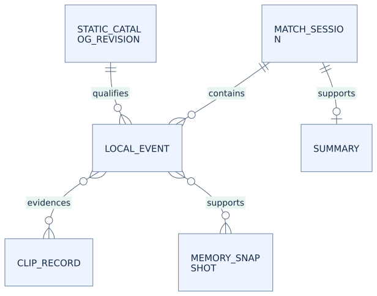

# Data Design Description (DDD)

## Model boundary

This Data Design Description defines the logical model and lifecycle constraints used by the SRS, ICD and SDD. Physical table/file layouts, serialization choices, migration scripts and retention defaults are not all frozen. Resolve DEC-SESSION and DEC-RETENTION before claiming persistence acceptance; freeze each chosen schema, migration/rollback path and corrupt-state recovery behavior in the implementation's design record. The entity inventory below does not mandate one database table per entity.

This is the new product's logical model. It is not a prescription to create a database table for every row. Persistent local records, transient runtime state and remote account data have different lifetimes and access rules.

| Entity | Key / relation | Required information | Lifetime / authority |
| --- | --- | --- | --- |
| ProductIdentity | stable app_id | Display name, package IDs, data path, URI/signature namespaces | Version controlled; no secrets |
| UserSettings | local profile + schema_version | Locale, hotkeys, overlay, sensitivity, local cloud/mic preferences; no persisted peer activation, fresh join consent or room credentials | Local; validated atomic write |
| MatchSession | opaque local session_id + epoch | Supported mode, admitted owner/team, start/end and completion evidence | Local; never cloud or peer raw ID |
| Observation | source + generation + sequence | Value, availability, age, owner/session admission | Bounded memory; only permitted facts archived |
| LocalEvent | event_id + session epoch + sequence | Type, monotonic time, source facts, evidence quality | Local JSONL; no raw mic or peer stats |
| StaticCatalogRevision | content hash + patch | Hero/item/ability facts, source and coverage provenance | Local immutable version |
| Summary | session_id + snapshot version | At most 3 claims, event refs, timestamp, completion status | Local; no fabricated outcomes |
| PlayerMemory | schema + source fingerprint | Source-supported aggregates and forget cutoff | Local snapshot; bounded |
| MediaInstallation | opaque install_id + revision | Container/payload hashes, authority class, verified registry | Local, installer owned |
| MediaLease | install revision + playback_id | Active immutable assets and completion/cancel fence | Runtime until playback/tail released |
| ClipRecord | local clip_id + media session | Time interval, verified event refs, path, coverage and partial reason | Local only; filename contains no raw player ID |
| PeerMembership | room/member + generation | Native credentials, consent generation, sequence, sample age | Memory only; never persisted |
| AccountSession | opaque account subject + generation | Broker-owned credentials and authenticated authority | Optional private account service |
| FriendRelation | two authorized account subjects | Mutual relation/block/settings; minimal projection | Private optional social storage |
| CapabilityLease | subject + installation + lease_id | Signed capabilities, expiry, key ID, revocation state | Native verifies; no gameplay gate |

## Relationships

[DGM-006 — editable source](../diagrams/source/DGM-006-logical-erd.mmd) · [Diagram notes](../diagrams/INDEX.html#DGM-006)

These relationships are local. There is no relationship permitting peer samples to populate PlayerMemory, and no account foreign key authorizing cloud export of local events.

## Availability and units

Every externally displayed observation has explicit availability: fresh, stale, unknown, invalid, unsupported or estimated. Unknown numeric values use null in normalized contracts and an em dash or explanatory label in UI. A real zero remains zero. A known-empty inventory slot is not an unknown slot.

Use integer milliseconds for local elapsed durations, integer seconds only where explicitly named respawn_seconds, percent in [0,100] for percentages, normalized coordinates in [0,1] for admitted map positions, integer game counters, decimal bytes for the 900,000,000-byte resource limit and full Working Set for memory accounting. Do not mix monotonic time with wall time or compare remote monotonic timestamps.

UTC timestamps are for evidence records and human correlation. Match progress/game clock is its own source-qualified domain; pause and unsupported modes cannot be approximated from a browser wall clock.

## Session identity

Keep raw game match ID and local platform identity in native local admission state. A positive string ID is not proof of ownership. A selected unit is not proof of the local hero. An opaque app session ID is not a replacement for these validation checks.

Invalidate admitted values on owner/team/session/source-generation changes. Stable UI entity key = session epoch + team/player slot; an identity revision prevents slot reuse from reusing a previous inspector response.

## Persistence and deletion

Use schema versions and migrations with backup/recovery paths. Memory clear first durably advances a nondecreasing logical/epoch forget cutoff comparable with archive source timestamps, then discards derived snapshots. This is not a process-monotonic clock value persisted across restarts; conservatively exclude sources with the same timestamp granularity. It must survive restart without re-learning earlier archives. A corrupt cutoff fails closed. Clearing memory and deleting history are separate user actions.

Define local-log and clip retention quotas before shipping. Until DEC-RETENTION closes, do not implement destructive automatic eviction or claim unlimited storage. On disk pressure, stop new recording or bounded writes with clear status; preserve usable files and core alerts.

Media installation uses staging + integrity verification + atomic registry commit. Registry revisions and lease references prevent deleting or mutating assets currently in use. A local installation does not grant publisher authenticity or store entitlement.

## Provenance for static facts

Store game patch, source locator, retrieved date, curator/generator identity, input hashes, schema version and coverage status with every static catalog. No field defaults to latest. Untested hero classes and unverified damage interactions remain unsupported. Different source patches cannot be silently merged into an apparently current build recommendation.

## Related engineering diagrams

- [DGM-004 — Local data flow and lifetime separation](../diagrams/INDEX.html#DGM-004)
- [DGM-006 — Local logical entity relationships](../diagrams/INDEX.html#DGM-006)
- [DGM-015 — Durable forgetting without history deletion](../diagrams/INDEX.html#DGM-015)
- [DGM-019 — Own-source admission and freshness](../diagrams/INDEX.html#DGM-019)

Read each figure with its catalog notes and linked SRS requirements. Short labels do not replace failure, consent or cancellation guards. The [diagram index](../diagrams/README.md) provides editable sources and maintenance rules.
