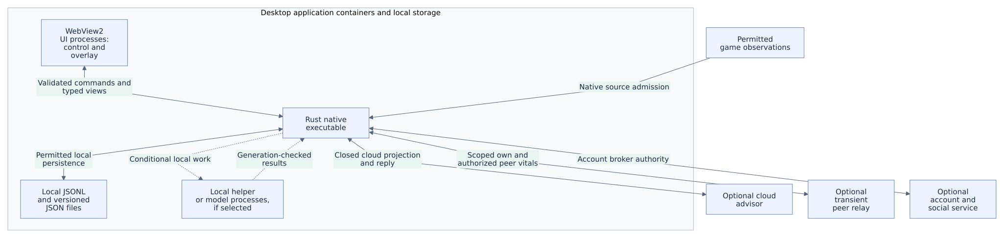

# Software Architecture Description (SAD)

## 1. Purpose, scope and authority

This document describes the system's architectural boundaries, allocation of responsibilities, runtime collaboration, deployment context and decision rationale. It explains how the design can satisfy the [SRS](../requirements/SRS.md) within the product scope established by the [PRD](../product/PRD.md). It does not replace either document or record an implementation/performance pass.

The component contracts and state behavior are elaborated in the [SDD](SDD.md). The [ICD](ICD.md), [DDD](DDD.md), [UX specification](UX-SPEC.md), [security/privacy specification](../security/SECURITY-PRIVACY.md) and [NFR](../quality/NFR.md) describe their respective views. Open decisions are controlled by the [decision log](../governance/DECISION-LOG.md).

The baseline targets a new product identity with an independent trust namespace. It supplies no deployed cloud service, signing secret, licensed asset collection or claim of compatibility with a previous product. Deferred services remain unavailable until their own contracts and evidence exist.

## 2. Stakeholders and architectural concerns

| Stakeholder | Concern | Architectural response and review evidence |
|---|---|---|
| Player during a match | Timely information without focus theft or gameplay disruption | Native critical path, passive overlay, bounded work and actual acoustic/FPS evidence |
| Player managing personal data | Understand what is observed, shared, retained and forgotten | Separate data projections and consent domains, local ownership, durable forget semantics and traffic/filesystem evidence |
| Guest/offline player | Use local functions without remote authorization | Account-independent startup; optional service failures remain separate |
| Consenting teammate | Correct recipients, current vitals and reliable leave behavior | Native-owned peer transport, room/match/team admission and generation/freshness fences |
| Product owner | Preserve intended MVP and extension boundaries through a rebuild | PRD-to-SRS traceability and explicit decisions for unresolved scope |
| Implementer/reviewer | Integrate components without guessing ownership or races | Stable component IDs, frozen interfaces, bounded queues and SDD state/cancellation rules |
| Validator/release operator | Reproduce results and recover safely | Exact-build receipts, declared environments, signed artifact identity and operational runbook |
| Optional service operator | Enforce authority without collecting gameplay unintentionally | Private service storage, purpose-specific credentials and independently reviewed deployment |

Each concern is evaluated against its stated evidence class. A browser prototype addresses layout behavior, not native capture, acoustic latency or resource containment.

## 3. Architecture viewpoints and correspondence

| Viewpoint | Question answered | Primary description |
|---|---|---|
| Context and responsibility | Which component owns each decision and which integrations are external? | Container responsibilities below; component allocations in SDD |
| Runtime and concurrency | What can execute concurrently, and how is stale work cancelled? | Lifecycle/concurrency below; SDD state machines |
| Information and trust | Where can each field move, persist or acquire authority? | DDD, ICD and SECURITY-PRIVACY |
| Deployment and resource | Which processes run on the player computer and which resources count? | Deployment context and resource containment below; NFR |
| User interaction | How do the control window and overlay present admitted state? | UX-SPEC and [use cases](../product/USE-CASES.md) |
| Verification and evolution | What proves compliance with this baseline and controls a change? | [Test Plan](../quality/TEST-PLAN.md), [RTM](../requirements/RTM.csv) and decision log |

Views must agree: a data-flow arrow does not authorize an export, a renderer state does not establish entitlement, and a deployment diagram does not prove process containment. A conflict blocks the affected integration until the governing requirements and design are reconciled.

## 4. Baseline technology

Retain the established baseline unless an ADR demonstrates a reason to change it: Tauri v2 shell, Rust critical core, React/TypeScript control and overlay, WebView2 on Windows, pnpm/cargo build tooling. Exact package/toolchain versions are selected and locked during M0; this document does not claim that a historical library or model version is current.

GSI intake may use an asynchronous loopback HTTP server. The accepted input port search starts at 3000 and may try through 3010, updating only the application's own game integration configuration. Bind loopback, constrain body size, validate game/source context and do not overwrite unrelated game configuration. The configuration file, intake token, body limit, admission mapping, ownership verification and session boundaries are proposed in the [Game-State Intake Specification](GSI-INTAKE-SPEC.md) under DEC-GSI-INTAKE; its assumptions about the game integration feature close only with M0 capture-spike evidence.

Retain DXGI read-only vision as the baseline. OBS is an external recorder controlled through authenticated loopback WebSocket v5, not an automatic replacement for the critical capture path. Local models are admitted only after whole-process resource measurements; shared external inference without verifiable accounting is unavailable.

## 5. Container responsibilities

[DGM-002 — editable source](../diagrams/source/DGM-002-containers.mmd) · [Diagram notes](../diagrams/INDEX.html#DGM-002)

The diagram shows responsibility boundaries; detailed data permissions in [SECURITY-PRIVACY](../security/SECURITY-PRIVACY.md) take precedence over an arrow. In particular, local history, memory and voice data do not feed cloud or peer projections. Container boundaries do not freeze the still-open model process topology.

| Component | Owns | Must not own |
| --- | --- | --- |
| Startup/resource governor | Process containment, startup guard, accounting | Silently excluding model/child processes |
| Telemetry admission | Raw parsing, own-owner/session check, freshness | Enemy stat invention or rendering |
| Vision observer | Capture health, geometry, class admission, sightings | Hidden game-state access |
| Risk estimator | Explicit versioned heuristic, valid coverage | Claims of calibrated probability without evidence |
| Alert engine | Hysteresis, cancellation generation, critical priority | Waiting on renderer, disk, network or LLM |
| Media/audio service | Verified immutable cache, audio and visual lifecycle | Renderer-selected independent event media |
| Read-model builder | Typed availability/source/age projection | Guessing missing values or granting authority |
| Voice service | Bounded PTT lifecycle, local STT/answer, transient audio | Cloud fallback or raw audio telemetry |
| History/memory | Local evidence, atomic aggregates, forget cutoff | Peer data accumulation |
| Network adapters | Separate cloud/peer/account projections | Sharing a universal serialized game object |
| Recorder | Explicit OBS media session, off-path clip planning | Blocking urgent alerts or implicit mic |
| Updater | Trusted endpoint/public-key check, staged safe install | Account-dependent core unlock |

## 6. Lifecycle and concurrency

Create/configure/assign the Windows process Job Object before constructing WebView or sidecars. On setup failure, log a safe code and exit 1. Runtime metric-query failure after successful containment is a distinct unavailable measurement; it does not disable the existing cap.

Every asynchronous operation carries the generations relevant to it: runtime session, source, account, consent, peer membership, package revision, entitlement and request. Revalidate on result delivery. Cancellation is monotonic: an old result cannot turn cancelled work back on.

Use bounded queues and latest-value slots for telemetry and read models. Network tasks have one bounded in-flight worker per service and may not take locks needed by the safety/audio path while awaiting I/O. Preload/decode/verify event media outside the critical path. Model loading, file hashing, archive unpacking, clip trimming and database work stay outside it.

## 7. Persistence choices

Use append-only local JSONL event archives and an atomic versioned JSON aggregate snapshot as the reference memory design. A new SQL store is permitted only after an ADR demonstrates value, schema/migration/retention rules and resource compliance. No database is needed for in-memory party membership.

Optional account/social persistence belongs to a distinct server boundary with row-level authorization. It is not a place to store gameplay, raw microphone data or local memory. A new service needs its own migrations, configuration, operational ownership and evidence before it becomes available.

## 8. Resource and failure containment

The application budget covers the native host, WebView processes, owned sidecars, every active inference/model process and an application relay running on the gaming computer: CPU ≤10% and aggregate full Working Set ≤900,000,000 bytes. External OBS is outside that application budget and must not be represented as a member of the application's process job.

For recording runs, report application, external OBS and combined CPU/RAM separately. No combined CPU/RAM ceiling is established by this draft. Record an explicit recording-profile budget decision before claiming overall recording-profile performance acceptance; an application-only pass remains scoped to the application. The existing game-FPS and urgent acoustic-latency limits still apply with recording active and must be measured in that configuration. Avoid accidental simultaneous capture routes. Failure in account, cloud, peer relay, model, media recording or informational GPU telemetry must not block valid local warnings.

The build should expose source health, media readiness and resource availability separately. A single green connected badge cannot imply game identity, vision quality, audio readiness, entitlement and recording are all working.

## 9. Deployment and operating context

The following is an allocation model, not an instruction to create every service immediately.

| Execution boundary | Allocated responsibilities | Operational interpretation |
|---|---|---|
| Player's native application host | Startup, game admission, observation coordination, alerts, media/audio, task cancellation, protected commands | Establish resource containment before UI/helpers; failure behavior remains as specified above |
| Application UI processes | Control interface and gameplay overlay consuming admitted read models | Render source-qualified state; no direct authority over credentials, remote requests or critical decisions |
| Owned helpers and active local inference | Approved device/model work outside critical admission | Include attributable processes in accounting; model unavailability does not disable valid local alerts |
| External OBS process | User-started local recording/replay buffering | Separate control and process ownership; measure separately and combined without inventing a combined cap |
| Optional peer relay | Transient membership and limited vitals exchange | Local testing or separately operated HTTPS service; no hosting is provided by this specification |
| Optional account/social service | Private identity, relations, invitation authority and related persistence | Server authorization; no dependency of guest gameplay or guest room-code access |
| Release/build environment | Build, sign, verify and promote candidate artifacts | Release secrets remain here; clients receive trusted verification material, not signing authority |

The supported Windows/game/geometry matrix and reference hardware are defined in the NFR. A control window on another display does not certify an additional capture layout. A missing microphone, model, media cue or remote service affects its own capability rather than turning all health indicators green or all local functions off.

Configuration and recovery procedures belong to the [runbook](../operations/RUNBOOK.md). Installation owns only its declared files and game integration configuration. The architecture does not authorize terminating unrelated OBS/model processes, destructive cleanup or automatic public deployment.

## 10. Architectural rationale

| Baseline choice | Reason and implication | Tradeoff retained |
|---|---|---|
| Native deterministic alert decisions | The urgent path can be measured without waiting on a provider or renderer | Models may enrich noncritical advice but cannot replace this decision boundary |
| Separate control window and passive overlay | Configuration/inspection and in-game presentation have different interaction roles | Both require native focus/DPI verification; a browser result cannot certify them |
| Separate source and session state | Capture failure need not erase valid own telemetry; temporary invalidity need not fabricate a new match | Consumers must carry source-specific availability and generations |
| Independent consent and adapter projections | Each recipient and purpose gets only its permitted fields | Additional consent/state handling is required; a universal game DTO is unsuitable |
| Verified media prepared off the hot path | Package validation/decode cannot consume the critical admission budget | Missing critical assets remain a readiness blocker; no implicit synthesized replacement |
| JSONL journal plus versioned snapshot | Retains inspectable local evidence and reproducible bounded aggregates | Retention, completion and snapshot migration still need explicit contracts |
| External recording through OBS | Implements the requested recording slice without redefining the critical observation source | External lifecycle, encoder load and combined-resource acceptance need separate evidence |
| Optional account/premium services | Identity and presentation authority remain independent of gameplay access | Remote capability loss must preserve the base view and local safety functions |
| OS containment plus independent measurement | Resource setup has a defined fail-closed boundary and a measurable runtime state | Intended child inheritance is insufficient; actual membership and cleanup require native proof |

These reasons explain existing choices; they do not add a feature or relax an obligation. A different approach requires a recorded decision identifying affected SRS IDs, interfaces, evidence and rollback.

## 11. Open design tradeoffs and architecture risks

| Decision | Choice still to close | Safe boundary until closure |
|---|---|---|
| DEC-INTERFACES | Exact game-input authentication/body limits, commands, event taxonomy, wire/framing and compatibility | Use specified constraints for local prototypes; do not claim complete interoperability |
| DEC-MODELS | Vision artifacts before the relevant capture milestone; local speech/answer artifacts before voice integration | Unknown model coverage or unaccounted providers remain unavailable |
| DEC-GAME-DATA | Certified classes, current catalog provenance and full-MVP action-damage scope/formulas | No inferred unsupported hero/ability/damage claim |
| DEC-RISK-DETAIL | Coordinated-motion admission, death-related details and golden traces | Informational score cannot independently authorize audible missing-gank |
| DEC-VOICE-BUFFER | Single PCM ownership, decoder lifetime and zeroization | Capture-only slice discards bytes and reports unavailable STT |
| DEC-SESSION / DEC-RETENTION | Complete/partial semantics, archive/clip bounds and deletion | Preserve truthful partial history; no silent destructive eviction |
| DEC-PACK-CRYPTO | New canonical signing bytes, trusted keys and test vectors | No package-provided key establishes authority |
| DEC-OBS-BUDGET | Acceptance boundary for combined application-plus-recorder resources | Report separate and combined measurements; no unqualified overall recording-profile pass |
| DEC-SOCIAL / DEC-PREMIUM | Private service schemas, transaction order, revocation and operations | Guest/base local behavior remains available; authority-dependent features stay unavailable |
| DEC-NATIVE-EVIDENCE | Actual devices, profiles, matches and operators | Record NOT_RUN/SKIP/INDETERMINATE where appropriate, never synthetic success |

The decision log remains authoritative for status and closure evidence. This table identifies architectural consequences, not new approvals or alternative thresholds.

## 12. Design allocation and evolution

The SDD refines the responsibility groups into the sixteen stable component IDs. In particular, startup containment and performance accounting are separated into CMP-STARTUP and CMP-PERFORMANCE, while purpose-specific network responsibilities map to CMP-ADVICE, CMP-PEER and CMP-SOCIAL. Deferred presentation authority is allocated to CMP-ENTITLEMENT without moving authority into the UI.

The [feature catalog](../product/FEATURE-CATALOG.md) retains reference algorithms and their scope; the [media specification](MEDIA-PACK-SPEC.md) owns package/playback detail. The [delivery plan](../delivery/SDP.md) orders integration without treating a demonstration as a completed MVP.

Maintain SRS → component → interface/state → test → evidence correspondence in the RTM. Do not change an algorithm while reorganizing this document. Changes to scheduling, data ownership, process boundaries, protocol semantics or source admission need impact analysis and a versioned decision.

## Related engineering diagrams

- [DGM-001 — System context](../diagrams/INDEX.html#DGM-001)
- [DGM-002 — Application containers and local storage](../diagrams/INDEX.html#DGM-002)
- [DGM-003 — Deployment and resource accounting](../diagrams/INDEX.html#DGM-003)
- [DGM-007 — Contained offline startup](../diagrams/INDEX.html#DGM-007)

Read each figure with its catalog notes and linked SRS requirements. Short labels do not replace failure, consent or cancellation guards. The [diagram index](../diagrams/README.md) provides editable sources and maintenance rules.
