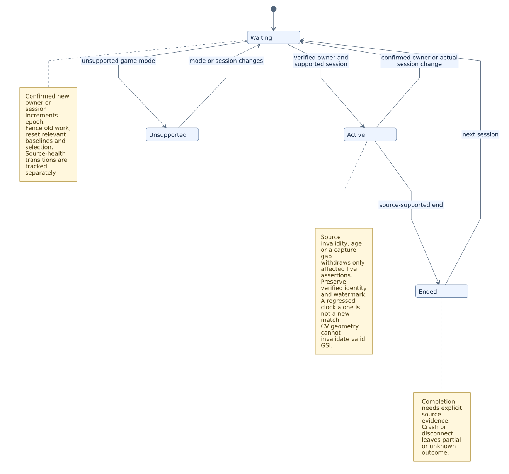
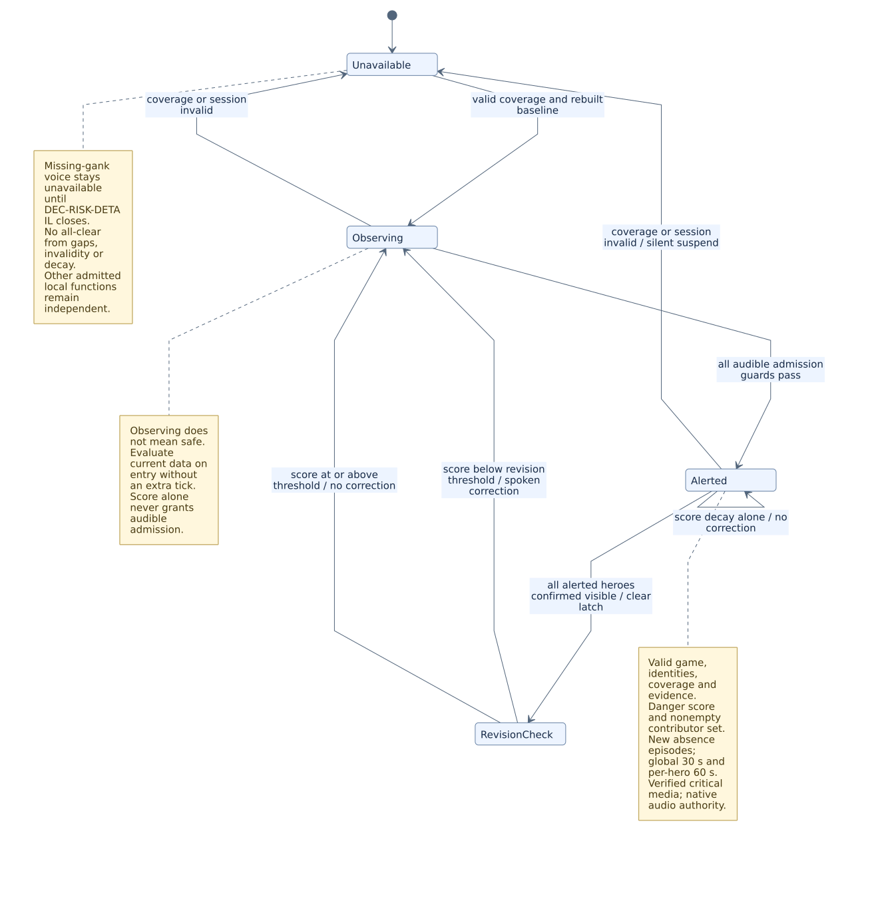
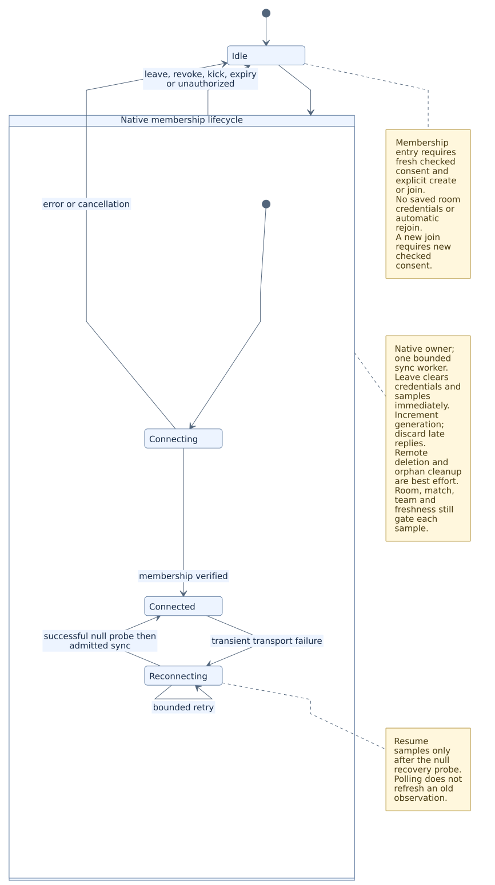

# Software Design Description (SDD)

## 1. Purpose, scope and design authority

This SDD refines the [SAD](SAD.md) into stable component responsibilities, inputs/outputs, failure handling, cancellation and state algorithms. It allocates the [SRS](../requirements/SRS.md) obligations without changing their IDs, scope, thresholds or permissions. The [PRD](../product/PRD.md) and accepted decisions remain governing inputs.

Component IDs identify responsibilities, not mandatory repositories, processes, worktrees or public APIs. Several components may share a native process while retaining the described ownership and concurrency boundaries. Exact commands, envelopes and persisted shapes are frozen through the ICD/DDD decisions, not inferred from a table cell.

This is a design draft. An allocation does not claim that code exists, that a deferred feature is admitted, or that runtime verification has passed.

## 2. Design inputs and correspondences

| Design input | Role in this document |
|---|---|
| [ICD](ICD.md) | Exact transport, command/event, error and compatibility contracts |
| [DDD](DDD.md) | Keys, units, source provenance, persistence, erase and migration rules |
| [Feature catalog](../product/FEATURE-CATALOG.md) | Reference heuristic algorithms and capability scope |
| [Media package specification](MEDIA-PACK-SPEC.md) | Event taxonomy, archive/media admission, authority and paired playback |
| [UX specification](UX-SPEC.md) / [use cases](../product/USE-CASES.md) | Observable interaction and alternate paths |
| [SECURITY-PRIVACY](../security/SECURITY-PRIVACY.md) | Data routes, consent, credentials and authorization |
| [NFR](../quality/NFR.md) / [Test Plan](../quality/TEST-PLAN.md) | Measurement limits, methods and evidence classes |
| [Decision log](../governance/DECISION-LOG.md) / [RTM](../requirements/RTM.csv) | Open design choices and requirement/design/test correspondence |

A component accepting an input does so only under the relevant data/authority contract. No input/output row creates a new data source, remote recipient or credential permission.

## 3. Component design and requirements allocation

Each SRS requirement has one primary allocation below for traceability. Collaborators contribute to that obligation; primary allocation does not grant exclusive control over a shared source, require a separate service or eliminate cross-component tests. CMP-PERFORMANCE is the primary verification/instrumentation allocation for quality requirements; the measured runtime owners remain responsible for meeting them.

### CMP-STARTUP

**Responsibility name:** Startup and containment.

| Responsibility | Inputs | Outputs | Failure and cancellation |
|---|---|---|---|
| Establish the application runtime and mandatory process containment before UI/helper creation; preserve account-independent local startup. | Validated startup configuration, platform prerequisites and process-containment result. | Admitted local runtime or fail-closed startup result; owned process context for later accounting. | Containment setup failure reports a safe code and exits before UI/helpers. Optional account/network authority cannot unlock or block core startup. |

**Primary SRS allocation:** `CORE-001`, `CORE-002`.

**Collaborating components:** CMP-PERFORMANCE, CMP-INGEST, CMP-READMODEL.

### CMP-INGEST

**Responsibility name:** Game and catalog admission.

| Responsibility | Inputs | Outputs | Failure and cancellation |
|---|---|---|---|
| Own integration configuration, telemetry parsing, local-owner/session admission, valid-source age and static-catalog provenance. | Permitted loopback game payloads, verified local identity context, owned configuration and versioned catalog metadata. | Admitted observations or explicit invalid/stale/unsupported state; session/source fences and qualified catalog metadata. | Invalidity withdraws affected live values without fabricating a match boundary. Preserve verified identity/watermark until actual boundary evidence; stale callbacks cannot restore old samples. |

**Primary SRS allocation:** `CORE-004`, `DATA-001`, `DATA-003`, `DATA-004`, `DATA-006`.

**Collaborating components:** CMP-VISION, CMP-RISK, CMP-READMODEL, CMP-PEER, CMP-MEMORY.

### CMP-VISION

**Responsibility name:** Visible observation and tracking.

| Responsibility | Inputs | Outputs | Failure and cancellation |
|---|---|---|---|
| Admit read-only visible observations by capture health, geometry, session and certified class; maintain qualified visibility/missing inputs. | DXGI frames, calibration, supported class/model provenance and current session context. | Admitted sightings, coverage health and qualified absence information; no hidden enemy telemetry. | Capture/geometry gaps withdraw affected vision assertions and preserve independent valid telemetry. Unsupported classes remain unknown; OBS recording does not silently replace the source. |

**Primary SRS allocation:** `DATA-005`, `VISION-001`, `VISION-002`, `VISION-003`, `VISION-004`.

**Collaborating components:** CMP-INGEST, CMP-RISK, CMP-ALERT, CMP-READMODEL, CMP-PERFORMANCE.

### CMP-RISK

**Responsibility name:** Versioned heuristic computation.

| Responsibility | Inputs | Outputs | Failure and cancellation |
|---|---|---|---|
| Calculate the documented missing-time score from admitted inputs and label it heuristic. | Qualified sightings/absence history, valid coverage and the selected bounded parameter revision. | Finite source-qualified risk score and permitted estimated metadata for downstream admission. | Invalid coverage or obsolete session invalidates the result. Informational risk is not permission to play an audible alert or claim a calibrated probability. |

**Primary SRS allocation:** `ALERT-002`.

**Collaborating components:** CMP-VISION, CMP-INGEST, CMP-ALERT, CMP-READMODEL.

### CMP-ALERT

**Responsibility name:** Critical and visibility-notice admission.

| Responsibility | Inputs | Outputs | Failure and cancellation |
|---|---|---|---|
| Evaluate evidence, episode/cooldown, threshold, correction and media-readiness guards in the native critical path. | Admitted risk/observations, current session/game state, episode history, sensitivity and verified critical-media readiness. | Admitted warning/correction/missing-notice decisions, cancellation generation and truthful availability. | No waiting on cloud/model/renderer/relay. Gaps or missing evidence suspend affected claims, not an all-clear. Critical preemption does not acquire Voice locks. |

**Primary SRS allocation:** `ALERT-001`, `ALERT-003`, `ALERT-004`, `ALERT-005`, `ALERT-006`, `ALERT-007`.

**Collaborating components:** CMP-RISK, CMP-VISION, CMP-MEDIA, CMP-VOICE, CMP-PERFORMANCE.

### CMP-MEDIA

**Responsibility name:** Catalog, package and playback authority.

| Responsibility | Inputs | Outputs | Failure and cancellation |
|---|---|---|---|
| Own catalog consistency, ordinary arbitration, package verification/installation/activation and one paired audio/visual lifecycle. | Admitted native events, verified taxonomy, untrusted package bytes, selected revision and activation policy. | Install/activation result, immutable media lease, admitted playback and reason-coded silent/cancelled outcomes. | Invalid media preserves a healthy active revision. Late revision/session work is fenced; stop/mute/preemption cancels audio and visual tail. Integrity cannot grant publisher/store authority. |

**Primary SRS allocation:** `MEDIA-001`, `MEDIA-002`, `MEDIA-003`, `MEDIA-004`, `MEDIA-005`, `MEDIA-006`, `MEDIA-007`, `MEDIA-008`.

Catalog, arbitration, priority matrix, decode checks and install contracts are proposed in [EVENT-AUDIO-SPEC](EVENT-AUDIO-SPEC.md).

**Collaborating components:** CMP-INGEST, CMP-ALERT, CMP-READMODEL, CMP-VOICE, CMP-RECORDER.

### CMP-READMODEL

**Responsibility name:** Native projections and presentation adapters.

| Responsibility | Inputs | Outputs | Failure and cancellation |
|---|---|---|---|
| Build truthful source-qualified views and adapt them to the control window, passive overlay, selections and accessible interaction. | Admitted observations, independent health states, session/identity revisions and native presentation authority. | Typed availability/age values, stable map/cards, selected inspector state and explicit capability/readiness messages. | Unknown is not zero; no production fixtures or automatic selection. Discard stale inspector results and preserve focus/map during capability loss. Deferred timer presentation cannot own or invent the native game clock/store. |

**Primary SRS allocation:** `CORE-005`, `DATA-002`, `UI-001`, `UI-002`, `UI-003`, `UI-004`, `UI-005`, `UI-006`, `UI-007`, `UI-008`.

**Collaborating components:** CMP-INGEST, CMP-VISION, CMP-MEDIA, CMP-ENTITLEMENT, CMP-PERFORMANCE.

### CMP-VOICE

**Responsibility name:** Transient local conversation.

| Responsibility | Inputs | Outputs | Failure and cancellation |
|---|---|---|---|
| Own explicit mic/PTT permission, conflict-safe binding, one bounded local turn and transient capture/STT/answer lifecycle. | User-held PTT, microphone setting, default device, admitted local context, local model readiness and cancellation generation. | Transient local interpretation/answer, Normal-priority audio request and closed turn-state metadata. | No persistent speech/text or cloud fallback. Supersession/preemption/terminal failure fences callbacks and releases resources under DEC-VOICE-BUFFER. Missing or cold components report actual readiness. |

**Primary SRS allocation:** `VOICE-001`, `VOICE-002`, `VOICE-003`, `VOICE-004`, `VOICE-005`, `VOICE-006`, `VOICE-007`.

**Collaborating components:** CMP-MEDIA, CMP-ALERT, CMP-MEMORY, CMP-INGEST, CMP-PERFORMANCE.

### CMP-MEMORY

**Responsibility name:** Local journal, aggregates and forgetting.

| Responsibility | Inputs | Outputs | Failure and cancellation |
|---|---|---|---|
| Maintain approved local evidence and bounded derived snapshots/summaries with durable forget behavior. | Permitted local events/archive metadata, explicit completion/outcome evidence and user read/forget/delete actions. | Versioned source-supported aggregates, at most three complete-session summary points and durable forget acknowledgement. | Corrupt cutoff fails closed. No inferred outcomes, peer history or cloud export. Snapshot replacement is atomic; memory clear preserves separately governed journals. |

**Primary SRS allocation:** `MEM-001`, `MEM-002`, `MEM-003`, `MEM-004`, `MEM-005`.

**Collaborating components:** CMP-INGEST, CMP-READMODEL, CMP-VOICE, CMP-ADVICE.

### CMP-ADVICE

**Responsibility name:** Manual local and optional cloud advice.

| Responsibility | Inputs | Outputs | Failure and cancellation |
|---|---|---|---|
| Run noncritical manual advice using distinct local context and explicitly consented closed cloud projections. | Deliberate request, admitted backend, current allowed context and consent/session/backend generations. | Context-qualified advice or explicit unavailable result, with cancellable lower-priority delivery. | No silent remote request or universal serialized game object. Revocation/backend/session changes invalidate sends, cache and late results across retry/API/CLI paths. |

**Primary SRS allocation:** `ADVICE-001`, `ADVICE-002`, `ADVICE-003`, `ADVICE-004`.

**Collaborating components:** CMP-INGEST, CMP-MEMORY, CMP-READMODEL, CMP-MEDIA, CMP-PERFORMANCE.

### CMP-PEER

**Responsibility name:** Transient cooperative vitals.

| Responsibility | Inputs | Outputs | Failure and cancellation |
|---|---|---|---|
| Own fresh create/join consent, strict own-stat projection, native transport, bounded membership and conservative peer age. | Checked consent/action, validated relay origin, admitted own source and room/member/match/team context. | Authorized transient same-room/match/team vitals or waiting/stale/unavailable state; tokens remain native. | One bounded sync worker; null recovery probe before resumed publication. Leave clears local state and fences late work; remote deletion is best effort. No persistence or AI/history consumption. |

**Primary SRS allocation:** `PEER-001`, `PEER-002`, `PEER-003`, `PEER-004`, `PEER-005`, `PEER-006`, `PEER-007`, `PEER-008`, `PEER-009`, `PEER-010`.

**Collaborating components:** CMP-INGEST, CMP-READMODEL, CMP-SOCIAL, CMP-PERFORMANCE.

### CMP-SOCIAL

**Responsibility name:** Optional account and private social coordination.

| Responsibility | Inputs | Outputs | Failure and cancellation |
|---|---|---|---|
| Coordinate server-authorized private account/social operations while preserving guest/core independence. | Authenticated account/broker authority, relation/block settings, explicit presence/invitation actions and reviewed relay proof/ticket. | Authorized minimal social projection, transaction result and account generation changes. | Sign-out/revoke/switch invalidate account credentials/work only. Friendship is not sharing consent; failed social admission cannot silently become guest admission or expand gameplay recipients. |

**Primary SRS allocation:** `CORE-003`, `SOCIAL-001`, `SOCIAL-002`, `SOCIAL-003`.

**Collaborating components:** CMP-PEER, CMP-READMODEL, CMP-ENTITLEMENT.

### CMP-RECORDER

**Responsibility name:** Explicit external recording and local highlights.

| Responsibility | Inputs | Outputs | Failure and cancellation |
|---|---|---|---|
| Control a user-started OBS session and plan local clips from admitted events before ordinary audio filtering. | Explicit recording action, authenticated loopback OBS connection, session-bound events and actual buffer/save timestamps. | Save receipt, actual pre/post coverage, local trim/index result and independent recording health. | No implicit mic, fabricated save or critical-path blocking. Auth/disconnect/disk failures affect recording; combined performance acceptance remains subject to its budget decision. |

**Primary SRS allocation:** `OBS-001`, `OBS-002`, `OBS-003`, `OBS-004`, `OBS-005`.

**Collaborating components:** CMP-INGEST, CMP-MEDIA, CMP-READMODEL, CMP-PERFORMANCE.

### CMP-UPDATER

**Responsibility name:** Trusted update and release-support boundary.

| Responsibility | Inputs | Outputs | Failure and cancellation |
|---|---|---|---|
| Validate trusted update inputs, stage/defer safe installation and preserve exact-artifact release/recovery correspondence. | Trusted manifests/verification keys, candidate artifact identity, safe gameplay/media state and declared migration compatibility. | Verified staged/install result, explicit deferred/error state and artifact-bound promotion/recovery evidence. | No renderer-selected URL, account gate or unsigned fallback. Promotion is performed by the controlled release workflow using the same signed bytes; repair/rollback obey migration/version rules. |

**Primary SRS allocation:** `UPDATE-001`, `UPDATE-002`, `UPDATE-003`, `UPDATE-004`.

**Collaborating components:** CMP-STARTUP, CMP-MEDIA, CMP-READMODEL, CMP-MEMORY.

### CMP-ENTITLEMENT

**Responsibility name:** Deferred premium presentation authority.

| Responsibility | Inputs | Outputs | Failure and cancellation |
|---|---|---|---|
| Admit native-verified presentation capabilities independently of gameplay data and consent. | Reviewed server lease/subject/installation authority, expiry/revocation evidence and generation. | Base or admitted premium presentation capability with fenced detail/action state. | Absent/expired/revoked/unverifiable authority returns quietly to base. It never locks local core, enlarges source access or restores stale selections; service design remains deferred. |

**Primary SRS allocation:** `PREMIUM-001`, `PREMIUM-002`, `PREMIUM-003`.

**Collaborating components:** CMP-SOCIAL, CMP-READMODEL.

### CMP-PERFORMANCE

**Responsibility name:** Cross-component accounting and verification.

| Responsibility | Inputs | Outputs | Failure and cancellation |
|---|---|---|---|
| Own quality instrumentation, whole-application accounting and evidence aggregation for the frozen NFR; coordinate runtime measurement state. | Actual process counters, source/audio landmarks, frame timing, declared configurations and held-out labeled trials. | Independent metric health, raw local measurements and scoped evidence verdicts tied to build/environment. | Unavailable metrics are not zero or passing. Missing/failed prerequisites remain NOT_RUN/SKIP/INDETERMINATE/FAIL as applicable; no threshold change, process exclusion or synthetic live claim. |

**Primary SRS allocation:** `QUALITY-001`, `QUALITY-002`, `QUALITY-003`, `QUALITY-004`, `QUALITY-005`, `QUALITY-006`, `QUALITY-007`, `QUALITY-008`.

**Collaborating components:** CMP-STARTUP, CMP-VISION, CMP-ALERT, CMP-VOICE, CMP-RECORDER.

## 4. General rule

Each subsystem has an explicit owner and monotonic generation. State transitions are driven by admitted events, not renderer guesses. UI reflects native state. Late completions carry their old generation and are dropped.

## 5. Match and source lifecycle

[DGM-013 — editable source](../diagrams/source/DGM-013-match-lifecycle.mmd) · [Diagram notes](../diagrams/INDEX.html#DGM-013)

Match identity and individual source health are separate state domains:

| Event | Required transition | What remains |
| --- | --- | --- |
| Invalid own-source admission | Immediately withdraw own live values and prior peer publication | Preserve last verified match identity/watermark until actual boundary evidence |
| Valid-source age exceeds 2000ms | Mark this source stale and stop fresh assertions | Historical values may remain explicitly stale |
| Invalid/unsupported CV geometry or capture gap | Withdraw vision assertions, markers and vision-dependent audio | Valid GSI and independent local core remain active in telemetry-only mode |
| New admitted observation | Re-evaluate that source using the current epoch | Do not refresh another source merely because this one recovered |
| Confirmed new session/owner | Increment epoch and reset relevant baselines/selections | Persist only separately governed history |

The concrete evidence for "confirmed new session/owner" and for restart continuity is defined in [GSI-INTAKE-SPEC §6](GSI-INTAKE-SPEC.md). Temporary invalidity or a regressed clock is not itself proof of a new match. Completion requires explicit source evidence; a crash/disconnect produces partial or unknown completion. Capture geometry cannot move an otherwise-valid GSI session out of Active.

## 6. Risk hysteresis

[DGM-014 — editable source](../diagrams/source/DGM-014-alert-lifecycle.mmd) · [Diagram notes](../diagrams/INDEX.html#DGM-014)

Evaluate the current admitted observation on entry using all evidence and temporal guards; do not require an extra tick solely because coverage became available. The numeric risk score and audible admission are separate. Observing means no active admitted audible alert; it does not mean safe. At medium sensitivity danger is ≥0.65 and the revision threshold is <0.40. Low uses 0.85/0.50; high uses 0.50/0.30. Equality at the lower threshold does not satisfy revision.

An audible missing-gank alert requires all applicable guards:

- Admitted enemy identity/roster, valid continuing game/capture coverage, and a rebuilt baseline after any observation gap. Pregame, own hero dead, paused/nonadvancing game clock, non-game image or capture gap suppress this path.
- Evidence of multiple admitted enemies moving and disappearing close together in time/space, or an independently verified positional-evidence route with its own specified admission. A high missing-time score or missing-name count alone is insufficient. This draft does not create a new positional-evidence source.
- Finite risk at or above the danger threshold and a nonempty contributing-hero set.
- No contributing hero has already been notified for its current absence episode; at least 30 seconds since the last audible gank alert; and at least 60 seconds since the last alert for every contributing hero.
- Verified critical-media readiness and the native audio policy in [MEDIA-PACK-SPEC](MEDIA-PACK-SPEC.md). Unavailable media does not grant a visual-only or synthesized fallback.

Cooldown expiry alone does not create a new episode. Re-arm a hero only after admitted continuous reappearance, not a single noisy frame. Preserve cooldown history across capture gaps and enable/disable changes.

When all previously alerted heroes leave the admitted missing set through confirmed reappearance, clear that alert's latch. Emit the spoken correction only if the risk is also below the revision threshold at that evaluation; otherwise clear the old latch without claiming all-clear. Risk decreasing through time decay alone MUST NOT cause a correction. Coverage/session loss suspends the unsupported alert silently and changes availability; it is not evidence that the threat ended.

DEC-RISK-DETAIL must freeze the coordinated-motion admission parameters and positive/negative traces before audible missing-gank integration. Until then, the reference score is informational and the missing-gank voice path remains unavailable; unrelated local telemetry and other admitted alerts may proceed.

## 7. Voice lifecycle

Idle → Preparing → Listening → Decoding → Answering → Speaking → terminal status → Idle. One active request. Minimum hold 250ms, maximum 15s; a repeated held press is ignored and an unmatched release is ignored. A new valid press while decoding/answering/speaking supersedes the prior request.

Voice answers use Normal audio priority and are preemptible by ordinary announcer audio as well as critical audio. Interrupted answers cannot resume from a stale request. Critical audio cancels from every active state through an atomic cancellation generation without waiting on Voice locks. Mic-disabled, missing device, denied permission, 2s open timeout, missing model, short input and cancellation each have a closed reason. Every terminal exit releases and discards transient buffers. On PTT release the capture stream ends; any PCM handoff for decoding must obey the separately frozen DEC-VOICE-BUFFER ownership/zeroization deadline, not an implied unlimited retention. Terminal status never includes raw audio, transcript or answer text.

## 8. Peer membership

[DGM-012 — editable source](../diagrams/source/DGM-012-peer-lifecycle.mmd) · [Diagram notes](../diagrams/INDEX.html#DGM-012)

Leave clears local credentials/state immediately and increments cancellation generation; remote deletion is best effort. Late successful join attempts trigger orphan-membership cleanup. No autojoin after expiry and no saved credentials. A same-room invitation rotation affects future joins; kick and rotate have distinct effects.

## 9. Media installation and activation

Selected file → bounded staging → archive/schema/hash verification → registry commit → installed. Any failure before commit leaves the previous installation active. Activation is a separate transaction. If gameplay or an active media lease forbids a switch, activation remains deferred. Invalid new media must never invalidate a healthy active revision.

## 10. Recording

Idle → user-authorized starting → ready/replay-buffering → clip requested → save receipt → local trim/index. Any OBS failure changes recording health only; urgent local services remain available. A save timeout is not a successful clip. A partial pre/post interval must be labeled partial with actual times.

## 11. Capability transitions

Base → premium only after native trusted authority admits a currently valid lease. Offline with a valid lease retains premium. Expired, revoked or unverifiable authority immediately returns to base presentation and invalidates pending detail responses. No map shift, forced navigation, modal, sound or automatic selection is allowed. Native timers/producers and user consent are not owned by this presentation state.

## 12. Independent cancellation domains

| Change | Invalidate |
| --- | --- |
| Match/owner/source generation | Admitted samples, event baselines, risk, inspector and pending advice |
| Cloud consent off/backend change | Cloud sends, cache and late answers |
| Mic consent off | Active mic turn and buffer |
| Account signout/revoke/switch | Account/social requests and caches; preserve local core |
| Peer leave/kick/expiry | Membership credentials, samples and late responses |
| Pack revision or stop/mute | Audio/visual lifecycle according to the active lease policy |
| Capability loss | Premium selection/detail/actions; preserve base map and native services |

Compose these domains deliberately. A new account does not restart the game session; a new pack does not grant a Store purchase; a relay reconnection does not refresh the underlying observation.

## 13. Integration and design verification

The component table is an allocation view; the normative state rules above, the frozen interfaces and the SRS acceptance predicates apply together. Examples:

- A valid own observation reaches the native read model through CMP-INGEST; CMP-PEER performs its own narrower publication gate rather than forwarding that whole object.
- CMP-RISK may produce an informational score while CMP-ALERT keeps audible missing-gank unavailable pending complete evidence/admission definitions.
- CMP-MEDIA owns actual audio/visual admission; CMP-RECORDER observes eligible events independently of ordinary audio suppression.
- CMP-VOICE may read bounded approved local memory; CMP-ADVICE constructs its cloud projection separately and cannot reuse that local context as a cloud payload.
- CMP-ENTITLEMENT changes presentation capability, not ownership of producers, clocks, source admission or consent.
- CMP-PERFORMANCE records the scopes it actually measured; a component implementation or fixture pass is not a native/live result.

These examples restate the defined boundaries and do not introduce alternate algorithms. Missing interface/race details remain in the decision log and must close before the affected integration. In particular, deferred native timer-store details are not supplied merely by allocating UI-007 to its presentation adapter.

Design review checks every SRS ID against its primary component, relevant ICD/DDD contract, state transition and verification case. Review negative paths as well as successful output: invalid source, late response, revoked consent, capture gap, interrupted media, corrupt persistence, optional-service loss and unavailable measurements. Exact execution procedures and evidence belong to the Test Plan.

The [runbook](../operations/RUNBOOK.md) owns installation, operational configuration, release and recovery procedures. The [delivery plan](../delivery/SDP.md) sequences implementation. Moving a section or changing an identifier mapping cannot silently change runtime behavior, and no state-machine diagram substitutes for tests on the relevant native environment.

## 14. Resource governor (M1 proposal, DEC-GSI-INTAKE companion)

This section elaborates CORE-002 and QUALITY-002 for M1. It is a proposed engineering design within delegated authority. It does not change the 10% hard cap, the 900,000,000-byte ceiling or the 8% recovery hysteresis in the [NFR](../quality/NFR.md).

**Containment setup** (before any WebView2 or sidecar creation):

1. `CreateJobObjectW` (unnamed).
2. `SetInformationJobObject(JobObjectCpuRateControlInformation)` with `JOB_OBJECT_CPU_RATE_CONTROL_ENABLE | JOB_OBJECT_CPU_RATE_CONTROL_HARD_CAP` and `CpuRate = 1000`. That is 10% of total system CPU, in units of 1/100 percent.
3. `SetInformationJobObject(JobObjectExtendedLimitInformation)` with `JOB_OBJECT_LIMIT_KILL_ON_JOB_CLOSE`. `BREAKAWAY_OK` and `SILENT_BREAKAWAY_OK` are **not** set.
4. `AssignProcessToJobObject(job, GetCurrentProcess())`.

Any failure → `CPU_CONTAINMENT_FAILED`, sanitized log, exit code 1. No job memory limit is set: a hard memory limit would crash instead of degrading. The 900,000,000-byte ceiling is a measured acceptance limit, not a kill threshold.

**Membership verification:** after the WebView2 environment starts, enumerate job processes with `QueryInformationJobObject(JobObjectBasicProcessIdList)`. Every renderer, GPU and utility process of the owned WebView2 environment and every owned sidecar must be listed. A missing member is reported `METRIC_UNAVAILABLE` and fails the native containment test. It is not silently tolerated.

**Sampling:** once per second, compute normalized CPU = Δ(job total user+kernel time) / (Δwall × logical CPU count). Memory = sum of the full Working Set of the listed processes. These feed `runtime-status.resource` and the evidence receipts.

**Soft throttle** (inside the hard cap, so the critical path is not starved):

| State | Enter | Exit | Effect |
| --- | --- | --- | --- |
| normal | — | — | All work admitted |
| throttled | One sample ≥ 9.0%, or CPU metric unavailable, or memory `over_budget` | Three consecutive samples ≤ 8.0% with memory `available` and metric available | Halve vision capture rate (down to a floor of 2 fps); defer model warm-up, package hashing, archive compaction and clip trimming; drop renderer animation frames. Critical alert, audio and intake threads are never throttled |

**Intra-cap priority:** intake, alert and audio threads run at `THREAD_PRIORITY_ABOVE_NORMAL`. Background work runs at `THREAD_PRIORITY_BELOW_NORMAL`. Within the job's hard cap, the scheduler then favors the critical path.

**Limits of this design:** it does not establish that M3 capture/inference or M5 models fit inside 10%. That remains RISK-01 and the DEC-MODELS feasibility gate. The 9.0% entry threshold is an internal tuning value; change it through an ADR backed by measurements. Never change it in response to a failed acceptance run.

## Related engineering diagrams

- [DGM-008 — Evidence-gated native warning](../diagrams/INDEX.html#DGM-008)
- [DGM-009 — Local voice turn lifecycle](../diagrams/INDEX.html#DGM-009)
- [DGM-012 — Peer membership lifecycle](../diagrams/INDEX.html#DGM-012)
- [DGM-013 — Match identity and completion lifecycle](../diagrams/INDEX.html#DGM-013)
- [DGM-014 — Evidence-gated alert latch and correction](../diagrams/INDEX.html#DGM-014)
- [DGM-016 — Explicit local recording and measured clips](../diagrams/INDEX.html#DGM-016)

Read each figure with its catalog notes and linked SRS requirements. Short labels do not replace failure, consent or cancellation guards. The [diagram index](../diagrams/README.md) provides editable sources and maintenance rules.
