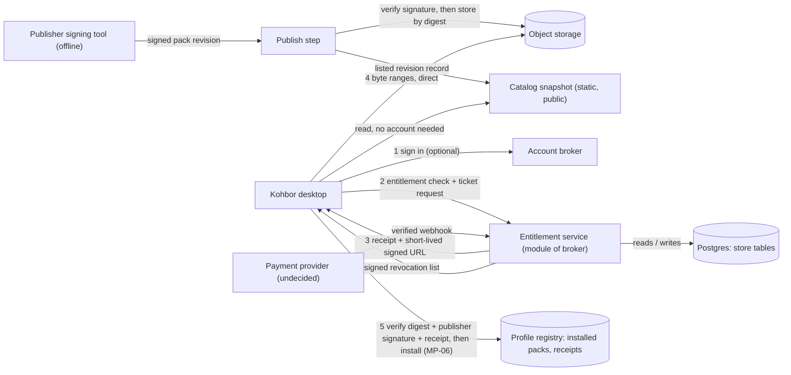

# Store and Pack Delivery Design

**Agent design, proposed. Not an owner approval, not a legal, rights, security or financial review.** The owner authorised writing this design on 2026-11-14 (request "เขียนเอกสาร", relayed by the coordinating session). Nothing is built, hosted, priced or paid for by this document, and no provider account or key was created. Every choice below is a recommendation with its alternatives; the owner-only decisions are collected in section 13, each under a DEC id (all open).

Evidence labels: `[R]` read in this repository; `[P]` proposed by the owner in chat on 2026-11-14 and still PROPOSED (pack object storage only; every other part of the alpha/beta stack was confirmed by the owner, `[O]`, as recorded in DEC-STORE-HOSTING and DEC-ACCOUNT-ORIGIN); `[O]` stated by the owner (2026-11-14, "ตามนั้นเลย", relayed by the coordinating session; recorded by an agent); `[U]` unverified. **This session had no network, so no external fact (any vendor price, limit, term or behaviour) is verified.** Section 14 lists every external fact with what must be checked before the owner relies on it.

## 1. Scope and what this document does not decide

In scope: how a Kohbor pack gets from a catalog to a player's machine, how entitlement is proven offline, what happens when services fail, and the order in which it can be built. Out of scope and left open: payments (section 9), prices, rights and licensing of any pack content (the owner's rights team; an owner statement that is unverified and not a rights grant, DEC-COMMERCE-INTENT), the premium relation (DEC-PREMIUM, deferred), and the visual design of the Store screens (DEC-VISUALS).

| Coordinator item | Section |
| --- | --- |
| 1 Architecture | 2 |
| 2 Data model | 3 |
| 3 Client behaviour | 4 |
| 4 Integrity versus piracy | 5 |
| 5 Failure modes | 6 |
| 6 Capacity and cost | 7 |
| 7 Alpha versus production | 8 |
| 8 Payments boundary | 9 |
| 9 UI states | 10 |
| 10 Build order and blockers | 12 |

Starting facts, all `[R]`:

- Store, wallet and payments are a later service; the Store destination stays visible with an honest unavailable state and never gates local gameplay (FEATURE-CATALOG, UX-SPEC section 2).
- Installation and activation are separate transactions with idempotent retries; the profile registry owns installed revisions; prior revisions are retained and a playing revision is leased (MP-06, MP-07).
- Integrity, authenticity, entitlement and selection are evaluated independently; a valid hash proves no purchase; a local import never gains store authority; a package-supplied public key never establishes trust (MP-09, MEDIA-008). Authority-dependent operations stay unavailable until the signed-authority ADR and its tests exist (MP-09).
- Sign-out, revocation and account switch invalidate account requests and credentials while preserving local gameplay and history (CORE-003). Sign-in is optional; guests keep every local feature (DEC-SIGNIN-OPTIONAL).
- The account service persists only the rule 26 list and never email, raw Google subject, tokens or IP history (ACCOUNT-IDENTITY-REVIEW rule 26). Two deployables with Ed25519 tokens of one audience each (REMAINING-SYSTEM-DESIGN D8). Updates are signed and independent of the account (UPDATE-001).
- The recommended default for a later Store is signature plus entitlement with no encryption (PACKAGE-FORMAT-REVIEW section 7).

## 2. Architecture

### 2.1 Components

| Component | Does | Holds | Never holds |
| --- | --- | --- | --- |
| Client (desktop host) | Browses the catalog, requests a download ticket, downloads, verifies, installs under MP-06, stores the receipt, applies the revocation list | Installed packs and receipts in the profile registry; a cached catalog and cached revocation list | Payment data; any signing private key |
| Catalog snapshot | A public, read-only list of listed packs and their revisions (id, title, digest, size, publisher signature, withdrawn flag). Static file, no account needed to read it | Public metadata only | Anything about a person or an entitlement |
| Entitlement service | Checks an account's entitlement, issues receipts and download tickets, publishes the signed revocation list, receives payment events (section 9) | The store tables of section 3 | Email, name, address, payment instrument, IP history, relay data |
| Object storage | Stores pack container files by digest-named key; serves short-lived signed GET URLs directly to the client, with byte ranges `[U]` | Pack files (not secret under P1, section 5) | Any account data |
| Account broker | Verifies Google ID tokens, issues sessions and Ed25519 access tokens (audience `broker`), friend codes | Rule 26 list | Anything in the store tables |
| Publisher signing tool (offline) | Signs a pack revision record with the publisher key at publish time | Publisher private key, on the publisher's machine only | n/a |

**Recommendation: the entitlement service is a module of the account broker, not a third deployable.** It reuses the broker's sessions and access token (audience `broker`), so D8 keeps two deployables and no new audience (ACCOUNT-007 as proposed). Code lives in its own crate (`kohbor-store-core`, name proposed) so it can split into its own deployable later without a rewrite; splitting would then add the audience `store` and a broker-signed exchange. Alternative: a separate store deployable from the start (cleaner failure isolation, one more service and token audience to operate). Chosen for the alpha because the owner runs everything on one PC and a store outage must not look different from a broker outage anyway.

Nothing large passes through the broker or the home PC. The broker returns a ticket (a URL and metadata, a few KB `[U]`); the client fetches the bytes from object storage.

### 2.2 Data flow

The block below is an inline design sketch, not a controlled diagram: the offline diagram renderer is not installed in this checkout, so no registered DGM view is added or regenerated. If the owner accepts this design, register it as a controlled view with the diagram tooling.

### 2.3 Keys and what each proves

Four independent signing domains; none may reuse another's key or domain label (MP-09 domain separation). Labels are labels, not hosts (AGENTS.md "Identity").

| Domain | Signs | Held by | Verified by | Lifetime |
| --- | --- | --- | --- | --- |
| Account token (D8) | Access and relay tickets | Broker, online | Broker, relay | Access 15 min, ticket 10 min `[R]` |
| Pack publisher | The pack revision record: pack id, revision, container digest, size | Publisher, **offline**; never on the server | Client (shipped trust root) and the publish step | Per revision |
| Store authority | Entitlement receipts and the revocation list | Entitlement service, online (a necessary exposure: receipts are issued at purchase and restore time) | Client (shipped public key set with key ids) | Receipt: permanent unless revoked; list: replaced by version |
| Updater (UPDATE-001) | App releases | Release process | Client | Separate path, separate key |

Consequence: a compromise of the online server can mint receipts (entitlement fraud) but cannot forge a pack, because pack signatures come from the offline publisher key. A compromise of the object store can swap files but not make them verify. Key ceremony, rotation and revocation are part of the signed-authority ADR (MP-09, DEC-PACK-CRYPTO); this document does not invent the wire format.

## 3. Data model

Logical model, not a migration. All store tables live in their own schema, separate from the account schema, so the account allow-list and the store allow-list can be audited independently. The Postgres instance is a new project used as a database only (no vendor authentication product), never shared with another product `[P]`.

| Table | Columns (type is logical) | Notes |
| --- | --- | --- |
| `pack` | `pack_id` (the package id of the media manifest), `publisher_key_id`, `title` (localised map), `state` (draft, listed, withdrawn), `created_at` | Public. Price is deliberately absent: see section 9 |
| `pack_revision` | `pack_id`, `revision` (ordered), `container_digest` (SHA-256), `size_bytes`, `signature` (publisher signature over the record), `object_key`, `min_app_version`, `state` (staged, published, withdrawn), `created_at` | Public except `object_key`. Immutable once published; a fix is a new revision |
| `entitlement` | `entitlement_ref` (random, unguessable), `account_id`, `pack_id`, `revision_scope` (all revisions, or a named set), `state` (pending, active, revoked, refunded), `source` (order, owner_grant), `order_id` (nullable), `granted_at`, `ended_at`, `reason_code` | `entitlement_ref` is what a receipt and the revocation list carry. It is not the account id |
| `order` | `order_id`, `account_id` (nullable after account deletion), `pack_id`, `provider`, `provider_ref`, `state`, `price_snapshot` (shape depends on DEC-STORE-CURRENCY-TAX), `created_at`, `settled_at` | Opaque references only. The provider holds the buyer's identity and instrument |
| `revocation_entry` | `list_version`, `scope` (entitlement, pack_revision), `target` (an `entitlement_ref` or a pack id + revision), `reason_code`, `created_at` | Reason codes only, no free text. Contains no account id, so the public list identifies nobody |
| `ticket_counter` | `account_id` or `entitlement_ref`, window start, count | Rate-limit counter (allowed by rule 26), expires with its window |

**Allow-list and deny-list.** Rule 26 does not list entitlement, order or revocation data, so it must be amended before any store table is created; this design proposes the amendment below as a separate store list (applies ACCOUNT-IDENTITY-REVIEW rule 26 by extension; the account governance owner applies it, see Q-COM-1).

- The store schema persists only the columns above.
- It never persists: email, name, postal address, payment instrument or provider customer profile, IP address or per-download history linked to a person, presence, match data, or any pack content other than in object storage.
- Download counts are aggregate per revision, never per person.
- The revocation list and the catalog are public and carry no person.

**Account deletion (rule 27 says no tombstone).** Deleting an account removes its `entitlement` rows and its sessions and makes it unable to re-download. `order` rows may need to be kept for a legal period `[U]`; the recommended treatment is to detach them (`account_id` set to null, provider reference kept) rather than keep a person link, so retention does not re-identify the person. Whether retention is required at all, for how long and where backups stand is a legal question: DEC-STORE-RECORDS with DEC-PRIVACY-LEGAL. The deletion screen must say plainly that deleting the account ends the right to re-download purchased packs; packs already installed stay installed (section 4).

## 4. Client behaviour

Principle: **a store pack is an ordinary installed pack plus two pieces of evidence, a publisher signature and an entitlement receipt, both checkable offline.** The store is a way to obtain and to re-obtain packs; it is not a runtime dependency of playing them.

| Situation | Behaviour | Why |
| --- | --- | --- |
| Install | Staging, digest check, signature check, receipt check, then the MP-06 atomic commit into the profile registry. Installed form is permanent: it is a registry entry with prior revisions kept (MP-07), never a cache that the app may evict | MP-06, MP-07 |
| Server down, signed out, restart, offline | Installed packs keep working and are selected exactly as before. Nothing is fetched at startup as a condition of playback | Local core needs no account or network (CORE-001) |
| Receipt | Broker-signed, stored with the pack revision, verified offline against the shipped store-authority public keys. Carries `receipt_id`, `entitlement_ref`, `pack_id`, `revision_scope`, `issued_at`, `key_id`. **No account id, email or name** | A deleted account leaves only an unlinkable random reference on disk |
| Re-download (reinstall, new PC) | Sign in, read the library, request a ticket per pack; the broker checks the entitlement and re-issues a receipt with the same `entitlement_ref`. Unlimited reinstalls, subject to the ticket quota of section 6 | The library is derived server-side, so it survives loss of the PC |
| Refund or revocation | Recorded server-side, then published in the signed revocation list. The client applies it only at its next online check, and the pack leaves the active selection only at the next match barrier, never mid-match (MP-07 lease). The pack stays installed and shows as revoked until the user removes it | Revocation must not disturb a live match |
| Revocation list integrity | Signed, with a monotonic `list_version`. The client rejects a lower version than it holds (rollback) and keeps the last good list if a fetch fails | A blocked network must not erase a revocation already seen |
| Local import | Never gains store authority, even when the file is a copy of a store pack without a matching receipt (MEDIA-008). It installs as `local_import` as today | Only publisher signature plus matching receipt on the same pack id can grant store authority |
| Guests | Keep all local features and may browse the catalog (read-only, no identifier sent) if DEC-STORE-SCOPE allows. Buying and downloading need an account | DEC-SIGNIN-OPTIONAL: guests have no network sharing |
| Wall clock | **No entitlement decision depends on the local clock.** Receipts have no expiry; the revocation list uses its version, not a date. "Last checked" is informational | Wrong clocks must not lock out a paying user or hide a revocation |
| Match in progress | Downloading may continue throttled or pause; verification and install work waits for the match barrier. Install is never activation (MP-06) | CPU cap of QUALITY-002; the cost of hashing a pack on the dev machine is a measurement not yet taken `[U]` |

### 4.1 Decision: sign-out and account switch keep purchased packs (recommended)

CORE-003 invalidates account requests and credentials and preserves local gameplay and history; installed packs are local state in the profile registry, not account data. Recommendation:

- **Sign-out and account switch do not remove installed packs and do not deactivate them.** Their entitlement shows as "not verified for the current account" only in the Store library, which is locked until sign-in. No message appears during play.
- A different account signing in on the same profile does not gain the library of the previous one; it sees the packs as installed, and the revocation list still applies to them by `entitlement_ref`.
- **Account deletion** wipes the account cache (rule 27) but not installed packs or their receipts.

Cost, stated plainly: a purchased pack that stays installed also plays for anyone using that PC profile, and the same applies to a copied profile. Without encryption there is no technical way around it (section 5). The alternative, deactivating store packs on sign-out, makes a paying user lose packs when the service or sign-in has a problem and contradicts "installed packs keep working". This is DEC-STORE-OFFLINE-POLICY, owner-only; the section above is the recommended default.

A safety note for the media owner: if a store pack is the only source of a critical cue, revocation would make critical readiness unavailable (MP-08). Store packs should not be the sole provider of critical cues; that is a DEC-CRITICAL-MEDIA matter, flagged here and not decided here.

## 5. Integrity versus piracy

**This design does not stop a person from sharing a purchased file.** Under the recommended default, a pack file is an ordinary container; anyone who can read the installed folder or the downloaded file can send it to someone else, and a copy installs as `local_import` and plays in Kohbor without any entitlement. What the design does provide:

| Property | Provided by | Stops |
| --- | --- | --- |
| Corruption and tampering are detected | Container digest, per-file digests | Damaged or modified files installing |
| The pack really came from the publisher | Publisher signature, offline key | Third-party fake "official" packs |
| This account bought this pack | Receipt plus library, issued by the entitlement service | Presenting a copy as store-authorised, getting updates, re-downloading, showing as owned |
| A refund can take effect | Signed revocation list at the next online check | Continued store-authorised use after a refund, for users who go online |

The best case of any encryption scheme is to stop casual file copying; the app must decode the audio on the user's machine, Windows lets other programs record what the output device plays, and a key must be available offline, so the user can reach it `[R]` PACKAGE-FORMAT-REVIEW section 7(c). That review cites Microsoft's loopback-recording documentation as read on 2026-11-12; this session did not re-verify it `[U]`.

### 5.1 Options for DEC-PACK-CRYPTO (owner-only)

| | P1: signature + entitlement, no encryption (**recommended**, with P3 terms) | P2: encrypted payloads, key released after entitlement | P3: terms only |
| --- | --- | --- | --- |
| Stops | Use as "Store-authorised" without a purchase, inside Kohbor | The same, plus casual copying out of the data folder | Nothing technical |
| Does not stop | Copying the files; recording output | Recording output; reading the cached key; sharing decrypted audio | Anything |
| Cost | The signed-authority work already required (MP-09), plus this document's service | P1 plus a key service, per-device or per-account key wrapping, an offline grace policy, encrypted installed form, decrypt during prewarm and in the video range server, an encrypt step in publishing, key-loss support (weeks and a running service `[U]`, not estimated in detail) | A licence text |
| User impact | None | A paying user can be locked out offline or after reinstall; and critical readiness (MP-08) would depend on a key service | None |

Choose P2 only if a rights holder makes it a contract condition, and present it as a deterrent, not prevention. No technology settles who holds rights to the owner's existing clips, and encryption cannot create a licence (rights team; unverified `[U]`).

## 6. Failure modes

Rule for every row: **installed packs keep working; the failure is shown honestly in the Store only.**

| Failure | Effect | Handling |
| --- | --- | --- |
| Object storage unreachable or erroring | New downloads fail | Ticket still issued; client retries with backoff and shows "unavailable, try later". No fallback to serving from the home PC. A second storage mirror is an option, not recommended for the alpha (two sources to keep identical) |
| Broker or entitlement service down (home PC off, Tunnel down, database unreachable) | Cannot sign in, buy, get tickets, refresh the revocation list | The cached catalog still browses; installed packs work; the revocation list in hand stays in force; pending work resumes on the next successful call |
| Download interrupted | Partial file | Resume with byte ranges into staging; if the signed URL expired mid-download, request a new ticket and continue the same staged file; partial staging is deleted after failure or cancel |
| Corrupted download | Wrong bytes | Digest check fails; delete staging; retry once automatically, then report a reason code (no automatic loop) |
| Digest matches but signature invalid, or key id unknown | Untrusted pack | Refuse install (MP-09); the file stays out of the registry; the message distinguishes a missing trust key (update the app) from a bad signature |
| Digest mismatch against the catalog record | Swapped or stale object | Refuse; report; mark the revision for the owner's attention |
| Revoked pack | Entitlement ended | Section 4: applied at next online check and next match barrier; shown as revoked, not as an error |
| Receipt signed by a key id the client does not know | Newer key set needed | Pack stays as installed without a store badge; prompt to update the app (updater path, independent of the store) |
| Clock skew | None for entitlement | No decision uses the local clock (section 4). Skew only affects the server-side expiry of a ticket or token, and the server's clock decides; a 401 triggers a refresh |
| Download quota reached (per account or per entitlement per window) | New ticket refused | A clear "limit reached, try again later" with no tally of who downloaded what; proposed starting values are the owner's choice and `[U]` |
| Disk full or staging cannot be written | Install fails | Fail before commit; the registry is unchanged (MP-06 atomic commit) |
| Duplicate, out-of-order or replayed payment event | Wrong entitlement state | Idempotent by provider event id; a refund seen before its purchase is held until the purchase arrives (boundary only, section 9) |
| Revocation list fetch fails or is rolled back | Stale list | Keep the highest version held; never apply a lower one |
| Account deleted | Library gone | Installed packs stay; re-download is no longer possible (stated in the deletion screen) |

## 7. Capacity and cost sketch (all numbers `[U]`)

No vendor price or limit was verified. The sketch gives the arithmetic so the owner can substitute real numbers; the assumptions are placeholders to be replaced from the owner's actual packs.

| Assumption | Value | Source |
| --- | --- | --- |
| A1 pack size | 100 MB | Placeholder; measure from real packs |
| A2 packs listed, revisions kept | 50 packs, 2 revisions each | Placeholder |
| A3 alpha users and downloads | 1,000 users, 3 downloads per user per month | Placeholder |

| Quantity | Arithmetic | Result |
| --- | --- | --- |
| Storage | 50 × 2 × 100 MB | about 10 GB |
| Egress | 1,000 × 3 × 100 MB | about 300 GB per month |
| Object operations | 3,000 downloads × about 13 range requests (8 MB parts) | about 39,000 reads per month |
| Broker API load | about 10 calls per user-day | about 10,000 calls per day, about 0.1 per second average |
| Home PC network | ticket JSON only, about 2 KB per ticket `[U]` | negligible; the 300 GB never touches it |
| Database size | about 150 B per entitlement row × 3,000 | well under 1 MB |

What this does and does not show: at this scale cost is dominated by whether egress is free. R2 is proposed `[P]` because its egress is described as free `[U]`; on a store that charges per GB, 300 GB is a real line item and quotas (for example a Supabase Storage allowance) would likely bind first `[U]`. Free-tier limits, the behaviour on overrun (charge, throttle or block), and the Postgres inactivity pause on a free project `[U]` must be checked, and the alpha spending ceiling is THB 0 by the owner's statement `[O]` (DEC-STORE-HOSTING): any expected charge pauses the action and goes to the owner. **No part of this design may incur spend without a new owner decision.**

## 8. Alpha versus production

**Hosting part decided for the alpha/beta phase (DEC-STORE-HOSTING, provisional; DEC-ACCOUNT-ORIGIN; DEC-FRONTEND-HOSTING), owner statement "ตามนั้นเลย" 2026-11-14 `[O]`.** Production hosting and the final pack-storage choice stay open. The fuller operating notes (secrets, backups, monitoring, home-PC risks, who creates what) are in [BACKEND-STACK](BACKEND-STACK.md).

| Part | Alpha / beta (`[O]` unless marked) | Alternative named |
| --- | --- | --- |
| Web front end | Cloudflare Pages, built host-agnostic so it also builds for Vercel (DEC-FRONTEND-HOSTING) | Vercel or any static host |
| Broker, entitlement, relay | Docker on the owner's PC, exposed only through Cloudflare Tunnel (no port forwarding); Tailscale for owner administration only | Small VM later |
| Database | Supabase as Postgres only, no Supabase Auth, new project, never shared with another product | Self-hosted Postgres |
| Pack storage | Cloudflare R2, `[P]` PROPOSED (price and free-tier facts `[U]`) | Supabase Storage (named alternative) |
| App updates | GitHub Releases, signed, separate from the store (UPDATE-001) | n/a |

| Aspect | Alpha on the home PC | Production |
| --- | --- | --- |
| Uptime | Sleep, Windows updates, power or ISP loss all take the broker down. Clients degrade as in section 6; sign-in, purchase and new downloads wait | Hosted with monitoring and a stated target (owner sets) |
| Address and exposure | No public IP or open inbound port is needed with a tunnel `[U]`; the PC's origin address is not published `[U]` | Managed edge in front of a hosted origin |
| Isolation from the dev machine | The broker holds the store-authority private key and database credentials. It must not run in the same user session or share folders with source checkouts or secrets. Run it in its own container with only its volume mounted, its own OS user if possible, no host mounts of the repository | Dedicated host, no development tooling on it |
| Key custody | The online store-authority key is on that PC: acceptable for an alpha with no sales, written down as a limit. The publisher key is never on it (section 2.3) | A key service or hardware-backed signing, as the owner decides under DEC-PACK-CRYPTO |
| Backups | A free Supabase project has no guaranteed point-in-time recovery `[U]`, so the proposal is a scheduled logical dump (pg_dump), encrypted, to a second disk and to a copy off the PC, with a restore rehearsal before relying on it. Backup retention must respect account deletion (rule 27, DEC-RETENTION) | Provider backups plus the same dumps; restore objective set by the owner |
| Payments | **Disabled.** The alpha sells nothing; the owner can grant entitlements to named testers (`source` = owner_grant) through an owner-only admin path reachable over Tailscale | Section 9 once its decisions are closed |
| Rights | Distributing any pack, even free, to people outside the owner's own machines needs the rights team's documents; unverified `[U]` for the existing clips | Same, per pack, before listing |

## 9. Payments: boundary only, nothing designed

The only interface is one inbound event path.

| Direction | Event | Effect | Rule |
| --- | --- | --- | --- |
| Provider to entitlement service | Payment succeeded | Create `order`, then an `active` entitlement | Verify the provider's webhook authenticity and timestamp window, idempotent by provider event id |
| Provider to entitlement service | Refunded, disputed, reversed | Set `refunded` or `revoked`, add a `revocation_entry` | Same verification; held if its purchase has not arrived |
| Client to provider | Checkout | Open the provider's hosted checkout page in the system browser with an opaque per-order reference | No card or bank details enter Kohbor, the renderer or any log |
| Entitlement service to provider | Nothing | n/a | No provider key is created by this design |

Provider, currency, tax, refund policy, creator revenue share and the premium relation are not designed and are owner questions (section 13). Rights and licensing of any pack are never decided here.

## 10. UI states for the Store destination (for the ui-overlay steward)

A short list, no mockups; visuals follow DEC-VISUALS and the honest-unavailable rule of UX-SPEC section 2.

| State | What the player sees |
| --- | --- |
| Not in this build | Destination present with an honest unavailable message; nothing gates local play |
| Catalog, signed in | Packs with title and size, owned or not, install state |
| Catalog, guest | Browsable if DEC-STORE-SCOPE allows; Buy and Download replaced by "Sign in to continue" |
| Catalog offline | Cached catalog with an "offline" banner and the age of the snapshot; actions disabled |
| Library (inventory) | Owned packs from the service with installed, not installed, update available; locked with a sign-in prompt when signed out, while installed packs remain usable elsewhere |
| Downloading | Progress, pause, resume, cancel; queued during a match |
| Verifying / installing | Distinct from downloading; waits for the match barrier if a match is live |
| Installed | Active or inactive; "activates at next match" when deferred (MP-06) |
| Update available | New revision of an owned pack; the older revision stays until the new one is activated (MP-07) |
| Revoked | Calm, reason-coded, not accusatory; stays installed, leaves selection at the next match barrier; offers Remove |
| Unavailable / failed | Reason code in plain words: storage unreachable, service unreachable, digest mismatch, signature invalid, unknown key, disk full, limit reached |
| Receipt state on a pack | "Store pack", "Imported pack", or "Not verified for this account" |

## 11. Proposed requirements (not applied to the SRS)

Proposed ids for a later `store` module; the governance lead applies them if the owner accepts the design (Q-COM-1).

| Id | Statement |
| --- | --- |
| STORE-001 | No store state shall gate local gameplay, telemetry, alerts or playback of an installed pack |
| STORE-002 | An installed store pack shall be a permanent registry install with prior revisions retained, never an evictable cache |
| STORE-003 | Publisher signature, entitlement receipt and digest shall verify offline against shipped public keys |
| STORE-004 | A receipt shall carry no account id, email or name |
| STORE-005 | Revocation shall arrive only through a signed list with a monotonic version, take effect at the next online check and next match barrier, and never mid-match; a lower version shall be rejected |
| STORE-006 | No entitlement decision shall depend on the local wall clock |
| STORE-007 | A download shall use a short-lived URL issued after an entitlement check; the client shall verify digest and signature independently of the storage provider and shall resume interrupted downloads |
| STORE-008 | A local import shall never gain store authority (restates MEDIA-008) |
| STORE-009 | The store schema shall persist only its allow-list and never the deny-list of section 3 |
| STORE-010 | Sign-out and account switch shall not remove or deactivate installed packs |
| STORE-011 | A store outage shall not block app updates and an update outage shall not block the store |
| STORE-012 | Payment events shall enter only through a verified, idempotent provider webhook, and no card or bank data shall touch Kohbor |

## 12. Build order and what blocks each step

Nothing here is scheduled; the order is dependencies only. Steps in group A need no owner decision beyond acceptance of this design and can be built and tested without hosting or accounts.

| Step | Work | Needs |
| --- | --- | --- |
| A1 | Signed-authority ADR: schemas, algorithm, canonicalisation, domain separation, key distribution, rotation and revocation, test vectors (MP-09 gate) | DEC-PACK-CRYPTO (P1 portion) |
| A2 | Publisher signing tool and publish-time verification | A1 |
| A3 | `kohbor-store-core` with an in-memory fake broker, fake object store and fake provider (the D9 pattern); known-answer and negative tests | A1 |
| A4 | Client: verification, receipt storage, revocation list handling, resumable download against the fake, Store states of section 10 | A1, A3, accepted STORE-001..012 |
| A5 | Catalog snapshot format and the signed revision record | A1 |
| B1 | Alpha hosting: broker with entitlement module, R2 bucket, Postgres, owner-grant admin path, backups and restore rehearsal | DEC-ACCOUNT-ORIGIN, DEC-GOOGLE-PROJECT, DEC-STORE-HOSTING, rule 26 amendment, DEC-STORE-SCOPE, DEC-STORE-OFFLINE-POLICY, rights documents for any pack distributed |
| B2 | Alpha test with named testers on granted entitlements | B1; owner and tester native evidence (separate evidence class) |
| C1 | Payments, refunds, tax: provider webhook, checkout hand-off, reconciliation | DEC-STORE-PAYMENT-PROVIDER, DEC-STORE-CURRENCY-TAX, DEC-STORE-REFUND, DEC-STORE-REVENUE-SHARE, DEC-STORE-RECORDS, DEC-PRIVACY-LEGAL, DEC-PREMIUM (if relevant) |
| C2 | Production hosting and key custody | DEC-STORE-HOSTING (production), DEC-PACK-CRYPTO (custody), B-series evidence |
| C3 | Takedown handling for a withdrawn pack | DEC-STORE-TAKEDOWN, the rights team |

Evidence classes stay separate: fake-broker tests are synthetic; the alpha is a hosted run on one home PC; neither is a native acceptance or a live-match result.

## 13. Owner questions (each is an open DEC; recommendations are defaults, not decisions)

| DEC | Question | Recommended default |
| --- | --- | --- |
| DEC-STORE-SCOPE | What is sold (packs only?), is an account required to buy and to download, may guests browse the catalog, are free packs allowed, do updates of a purchased pack come with it, and does premium include or discount packs (DEC-PREMIUM)? | Packs only; account required to buy and download; guests may browse; updates included; premium relation left to DEC-PREMIUM |
| DEC-STORE-HOSTING (provisional: hosting part decided for the alpha) | Remaining: R2 versus Supabase Storage after the section 14 facts are checked, and where the production stack lives. Decided `[O]`: Pages, home-PC broker through Tunnel, Postgres-only Supabase, GitHub Releases, alpha sells nothing, alpha spending ceiling THB 0 | Keep R2 proposed until its facts are verified; no spend without a new decision |
| DEC-STORE-OFFLINE-POLICY | Sign-out, account switch and account deletion: installed packs stay; revocation staleness; revoked pack handling | Packs stay; revocation at next online check and match barrier; revoked packs stay installed but inactive |
| DEC-STORE-PAYMENT-PROVIDER | Which payment provider and which legal operator | None recommended; agents do not choose a provider |
| DEC-STORE-CURRENCY-TAX | Currency, price display and tax handling | None recommended |
| DEC-STORE-REFUND | Refund policy, chargebacks, and their effect on entitlement | Refund ends the entitlement through the signed list, as in section 4 |
| DEC-STORE-REVENUE-SHARE | Creator revenue share and payout | None recommended |
| DEC-STORE-RECORDS | Order-record retention versus account deletion and backups | Detach orders from the person; retention period from legal advice |
| DEC-STORE-TAKEDOWN | Effect on installed copies when a pack is withdrawn for rights reasons | Withdraw from the catalog and stop re-download; installed copies stay unless a rights holder requires removal |

Not agent-decidable and not decided here: rights and licensing of any pack, a payment provider, price, tax, legal basis, key custody beyond the alpha, and merge, push, deployment or any spend. Already open and referenced: DEC-PACK-CRYPTO, DEC-ACCOUNT-ORIGIN, DEC-GOOGLE-PROJECT, DEC-PRIVACY-LEGAL, DEC-PREMIUM (deferred), DEC-CRITICAL-MEDIA.

## 14. External facts register (none verified in this session)

All `[U]`. Before the owner relies on any row, check the vendor's current official page and record the date.

| Fact assumed | Where used | What to confirm |
| --- | --- | --- |
| R2 egress is free and storage and request prices are as recalled; free-tier allowances | Section 7 | Current pricing page; behaviour when the free tier is exceeded |
| R2 supports signed GET URLs, byte ranges and the expiry range this design needs | Section 2 | Documentation for presigned URLs and range requests |
| Cloudflare terms allow serving large pack files in the way chosen (through R2 directly, not through the proxied web cache) | Sections 2, 7 | Current terms on non-HTML content and on R2 public access |
| A tunnel needs no open inbound port and hides the origin address; a free-plan tunnel is permitted for this use | Section 8 | Tunnel documentation and terms |
| A free Postgres project has about 500 MB of storage, pauses when inactive, and has no guaranteed point-in-time recovery | Sections 7, 8 | Current plan page |
| GitHub Releases allow the app installer size and a download rate sufficient for the updater | Section 8 | Release asset limits and terms |
| Windows lets other programs capture rendered audio | Section 5 | Re-read the Microsoft loopback-recording page (cited by PACKAGE-FORMAT-REVIEW as read 2026-11-12) |
| Time to hash a 100 MB pack and its effect on the CPU cap | Section 4 | A measurement on the reference machine (QUALITY-002 method) |

## 15. Changelog

| Version | Date | Change |
| --- | --- | --- |
| 0.1.1 | 2026-11-14 | The hosting part of DEC-STORE-HOSTING is recorded as decided for the alpha/beta phase on the owner's statement (broker on the owner's PC through a Tunnel, Postgres-only Supabase, Cloudflare Pages host-agnostic, GitHub Releases, THB 0 alpha ceiling). R2 stays proposed. Section 8 updated; operating notes moved to BACKEND-STACK. |
| 0.1.0 | 2026-11-14 | First draft after the owner authorised a design: architecture, data model, client behaviour, failure modes, alpha and production notes, payment boundary, UI states, build order and nine owner questions. Nothing built, hosted, priced or paid for. |
